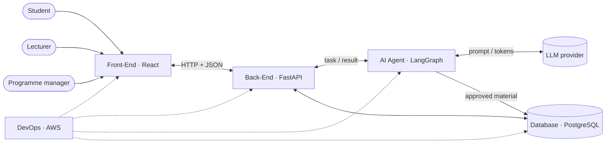
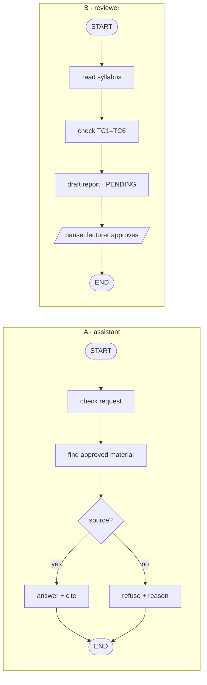

# Session 03 — Exercises: from the 5-block map to the first skeletons of MT-01

**Exercise book** · companion to the slide deck [`buoi-03.html`](buoi-03.html) (exercise slides `#ex1-brief` … `#ex4-steps`) and the lecture note [`buoi-3_lecture_note.md`](buoi-3_lecture_note.md) · course: *Mentoring for AI-aided Projects* · The Odyssey

> **How to use this file.** The slides carry the short version of each exercise. This file carries the full version.
> Every exercise has the same parts, in the same order as its two slides:
>
> | Slide 1 — the brief | Slide 2 — the steps |
> |---|---|
> | **Task** — the problem, the requirements, what goes in and what must come out | **Main steps** — high-level, each with an AI-aided method (a prompt, plan mode, a skill) and, for the first steps, the **manual** way |
> | **Input & tools** — knowledge, tools, files | **Manual — no AI** — sensitive or security steps a person must do |
> | **Expected output** — the files, with a figure or table of what is in them | **Keywords** — terms to look up for self-study |
>
> Each exercise ends with a **Done when** check you run yourself.
> Shell commands are written for **Git Bash** (the repo's default shell on Windows).

---

## Contents

| # | Exercise | After slides | Today | Continues in |
|---|----------|--------------|-------|--------------|
| 0 | [Before you start — the rules of the game](#0--before-you-start--the-rules-of-the-game) | — | read | — |
| 1.1 | [5-block map and stack](#exercise-11--5-block-map-and-stack) | 3 – 6 | steps 1 – 6 | every later exercise |
| 1.2 | [Front-end pages and APIs](#exercise-12--front-end-pages-and-apis) | 9 – 12 | steps 1 – 3 | buổi 4: steps 4 – 8 |
| 1.3 | [Back-end components and APIs](#exercise-13--back-end-components-and-apis) | 15 – 18 | steps 1 – 3 | buổi 4: steps 4 – 7 · DevOps: step 8 |
| 1.4 | [Agent job, rules and flow](#exercise-14--agent-job-rules-and-flow) | 24 – 26 | steps 1 – 2 | next chapter: steps 3 – 8 |
| A | [Appendix — self-learning prompts](#appendix--self-learning-prompts-with-claude-code) | — | any time | — |

Exercise slides in the deck: Ex 1.1 = slides 7 – 8 · Ex 1.2 = 13 – 14 · Ex 1.3 = 19 – 20 · Ex 1.4 = 27 – 28.

---

## 0 · Before you start — the rules of the game

### 0.1 One project, four exercises

Every exercise produces a file the next one reads. Nothing is a throw-away drill.

```
docs/de-bai.md ──► Ex 1.1  docs/systems/ARCHITECTURE_5BLOCK.md      (5 blocks + a technology each)
                     │
                     ├──► Ex 1.2  SPEC.md · UX.md · FE_PLAN.md + src/app …   (pages, components, API list)
                     │            │
                     │            └──► Ex 1.3  API.md · BACKEND_PLAN.md · tasks.json + src/api …  (endpoints, contract, auth)
                     │                        │
                     └────────────────────────┴──► Ex 1.4  AGENT.md · LANGGRAPH_NOTES.md + src/agent/  (job, rules, flow)
                                                          │
                                                          └──► buổi 4: build, wire, test
```

**Rule:** the first lines of every document you write in `docs/systems/` say which earlier files it is based on.

### 0.2 Who decides what

The repo's agent rules ([`.agents/rules/hoc-cung-ai.md`](../../../.agents/rules/hoc-cung-ai.md)) apply to these exercises:

| Claude does | **You** do |
|---|---|
| reads files, drafts documents, proposes options, scaffolds boilerplate | choose users, scope, framework, thresholds, what to keep or drop |
| explains terms, finds and summarises docs (with links) | open at least one link and check the summary is right |
| suggests a check | **run the check yourself** — "Claude said it works" is not a check |

If Claude in this repo answers "which do you prefer?" or "what did the `ERROR` line say?", that is the rules working, not Claude being unhelpful.

### 0.3 Four Claude Code ideas you need today

| Idea | What it is | Where it lives | When it acts |
|---|---|---|---|
| **CLAUDE.md** | Project memory: conventions, commands, rules. *Advice.* | repo root; a folder can have its own (`src/agent/CLAUDE.md`) | loaded at the start of every session (folder ones when Claude works there) |
| **Plan mode** | Claude reads and proposes, but **does not edit** until you approve | `Shift+Tab` until the status line shows plan mode | while you design |
| **Skill** | A reusable "how we do X here" package: instructions, optionally scripts and templates | `.claude/skills/<name>/SKILL.md` | **loaded when relevant** — Claude matches your request against the skill's `description`; you can also call it as `/<name>` |
| **Hook** | A shell command the Claude Code harness runs on an event (`PreToolUse`, `PostToolUse`, `UserPromptSubmit`, `Stop`, …) | `.claude/settings.json` (view with `/hooks`) | **always**, every time the event fires — Claude cannot "forget" it |

Rule of thumb: *if it is a preference, put it in CLAUDE.md; if it is know-how for one kind of task, make it a skill; if it must never be broken, make it a hook.*

> **This repo already has hooks.** `.claude/settings.json` runs `scripts/log_hook.py` on `UserPromptSubmit`, `PostToolUse` and `Stop` to log AI usage, and a separate **Git** pre-push hook ships the log. Do **not** call `scripts/log_*` by hand ([`.agents/rules/ai-log-hook.md`](../../../.agents/rules/ai-log-hook.md)). When you add a hook, **add** to the `hooks` object — never replace it.

---

## Exercise 1.1 · 5-block map and stack

**Slides:** `#ex1-brief`, `#ex1-claude` (7 – 8) · **Theory:** slides 3 – 6 · **Time:** 40 – 60 min

### Task

Read [`docs/de-bai.md`](../../de-bai.md) and design MT-01 as the five blocks of slide 3 — overview only, no endpoints, tables or code:

- the **general function** of each block (Front-End, Back-End, AI Agent, Database, DevOps);
- what **flows** between blocks, and where the **three roles** (student, lecturer, programme manager) enter;
- a **technology** for each block, with a short **reason taken from `de-bai.md`** (an application requirement or a scope limit).

### Input & tools

| | |
|---|---|
| **Knowledge** | 5-block architecture (slides 3 – 6) · client–server · roles and permissions |
| **Tools** | Claude Code — plan mode, CLAUDE.md, skills, hooks · Mermaid for the diagram |
| **Files** | `docs/de-bai.md` — *Ba năng lực*, *Ba vai và ranh giới quyền*, *Yêu cầu đầu ra*, *Phạm vi cố tình loại khỏi đề* · `docs/architecture_diagram.md` (template picture) |

### Expected output — `docs/systems/ARCHITECTURE_5BLOCK.md`

Two parts: a **block diagram** and a **table** — block · general function · potential technology · reason from `de-bai.md`. The stack this course uses is shown below as the *potential* answer; the team may choose differently, as long as each reason points to `de-bai.md`.

| Block | General function | Potential technology | Reason (from `de-bai.md`) |
|---|---|---|---|
| Front-End | pages per role: chat, report, dashboard | **React** | 3-role login (*Ba vai…*); scalable and production-ready (slide 10) |
| Back-End | checks the role, applies the rules, calls the agent | **FastAPI** | friendly language — Python, like the agent; `async` / `await` serves many requests at once; the server must refuse "approve" from other roles → 403 (*Ba vai…*) |
| AI Agent | answers and reviews from approved material | **LangGraph** | several steps — find, cite, refuse — and a pause until the lecturer approves (*B · Chuẩn hóa môn học*) |
| Database | users, syllabi, reports, approved material; optional cache + job queue (Redis / SQS) — only if needed | **PostgreSQL** | free; linked records and a `PENDING` status; no paid vector DB (*Phạm vi*) |
| DevOps | build, test, deploy, monitor | **AWS** | professional and reliable cloud for "Web app deploy công khai" (*Yêu cầu đầu ra*) |

> **Open decision.** `de-bai.md`, *Phạm vi cố tình loại khỏi đề*, says "Streamlit trước, đẹp sau" for the basic version. React now or later is the **team's** decision — write it under *Open decisions* (and, if React, in `ADR-001-frontend.md` in Exercise 1.2).

*Shape of the file (fill in your own words):*

````markdown
# MT-01 — 5-block architecture (overview)
Based on: docs/de-bai.md · slides 3–6 of buoi-03.html

## Block diagram


## Blocks
| Block | General function | Technology | Reason (de-bai.md section) |
|---|---|---|---|
| Front-End | … | … | … |
| Back-End | … | … | … |
| AI Agent | … | … | … |
| Database | … | … | … |
| DevOps | … | … | … |

## Open decisions (team to decide)
- Streamlit first or React now? (de-bai.md "Phạm vi cố tình loại khỏi đề")
- …
````

### Main steps

The repo, the team and `git clone` were set up in buổi 01 — run `git pull` and start from step 1.

| # | Step | AI-aided — Claude Code | Manual way |
|---|---|---|---|
| 1 | **Start + project memory** (once per repo) | `claude` · `/model` · `/init` drafts or updates CLAUDE.md → record the project's main information (prompt a, below) · set up the important skills and hooks — recommended: deep research, documentation, visualization, … | write CLAUDE.md yourself |
| 2 | **Read the brief** | prompt b | read `de-bai.md` with a pen: underline every role, every must / must not, every status (`PENDING`), every number (403, 360 px, 45 cases) |
| 3 | **Draw the diagram** — plan mode `Shift+Tab` | prompt c | draw the five boxes on paper, one sentence inside each, label every arrow |
| 4 | **Propose technologies** — the **interview** skill | prompt d — Claude compares and interviews you, **you** choose | list 2 options per block, tick the one each `de-bai.md` line supports |
| 5 | **Check against `de-bai.md`** | the `de-bai-guard` skill (part b below): `/de-bai-guard docs/systems/ARCHITECTURE_5BLOCK.md` | tick each rule of `de-bai.md` against the file |
| 6 | **Keep context small** | `/compact` in a long chat · `/clear` between tasks · `/context` to see what fills it | — |

`/init` **writes or updates CLAUDE.md** by scanning the repo — it does *not* explain the repo to you. This repo already has a CLAUDE.md with the course rules: `/init` will propose changes; keep the rules, review, then share it with the team. To *understand* the repo, ask Claude: `I am new to this repository. Without editing anything, list the top-level folders with one line each, and quote the files that describe the course and the brief.`

**Prompt a — CLAUDE.md, the project's main information** (more in part a below)

```text
Analyze docs/de-bai.md and record the main information for the project — main tasks, input,
output — in an "MT-01" section of CLAUDE.md. Cite the de-bai.md section for each line.
Keep every existing line unchanged. Show me the diff before saving.
```

Then set up the skills and hooks the team will reuse (recommended: **deep research**, **documentation**, **visualization**, …) — how to create a skill and a hook is in parts b and c below.

**Prompt b — read the brief**

```text
Read docs/de-bai.md. List the 3 roles and the capabilities of role A, B, C —
each with the section it comes from. Do not edit anything.
```

**Prompt c — draw the diagram (plan mode)**

```text
Read docs/de-bai.md and slides 3–6 of docs/giao-trinh/slide/buoi-03.html (#overview to #properties).
Plan docs/systems/ARCHITECTURE_5BLOCK.md at OVERVIEW level only:
a Mermaid flowchart with the five blocks (Front-End, Back-End, AI Agent, Database, DevOps),
the three roles and the external LLM provider; a one-line general function per block;
each arrow labelled with what flows. No endpoints, no table schemas, no code.
```

**Prompt d — propose technologies with the interview skill**

An *interview* skill (`.claude/skills/interview/SKILL.md`, created like part b) makes Claude ask **you** questions one at a time instead of deciding.

```text
/interview Choose a technology for each of the five blocks. For each block, compare 2 options
(e.g. React vs Streamlit for the Front-End) against docs/de-bai.md: the "Yêu cầu đầu ra" requirements
and the "Phạm vi cố tình loại khỏi đề" limits, one-line reason each, citing the section.
Then ask me one question at a time. Do not choose for me. When all five are answered,
add the "Blocks" table (block · general function · technology · reason) to ARCHITECTURE_5BLOCK.md.
```

### CLAUDE.md, skills and hooks — create, use, when

Slide 8 puts these three side by side, from softest to hardest. **Every next exercise uses all three**, so learn them now:

| | **CLAUDE.md** — advice | **Skill** — know-how | **Hook** — enforcement |
|---|---|---|---|
| **What** | project memory: conventions, commands, rules | a step-by-step procedure for one kind of task | a shell command Claude Code runs on an event; Claude cannot skip it |
| **Where** | `./CLAUDE.md`; a folder can have its own (`src/agent/CLAUDE.md`) | `.claude/skills/<name>/SKILL.md` | `.claude/settings.json` → `"hooks"` |
| **Create** | `/init` drafts it from the repo → edit with `/memory` or ask Claude → review → commit | write the file by hand, or ask “create a skill that…”. There is **no** `/skill` command | `/hooks`, or edit the JSON. **Add, never replace** — this repo already has 3 logging hooks |
| **Use** | automatic — loaded when a session starts (folder files when Claude works there) | Claude loads it when your request matches its `description`; or type `/<name>` | automatic on `PreToolUse`, `PostToolUse`, `Stop`, …; for `PreToolUse`, exit code 2 blocks the action |
| **When** | facts and preferences true for the whole project | a task you repeat with the same steps (review a design, add an endpoint) | a rule that must never break (protect `data/`, format after every edit) |
| **MT-01 example** | “Role checks live on the server” · “Never edit files in `data/`” | `de-bai-guard` — check a design against `de-bai.md` | `protect_data.py` — block edits to `data/` |
| **Next exercises** | a Front-end section (Ex 1.2) · a Back-end section (Ex 1.3) · `src/agent/CLAUDE.md` (Ex 1.4) | `ui-component` (Ex 1.2) · `add-endpoint` (Ex 1.3) · `add-node` (Ex 1.4) | format + type-check after each edit (Ex 1.2 – 1.3) · block edits to `data/` and reading `.env` |

Rule of thumb: **preference → CLAUDE.md · repeated procedure → skill · must never break → hook.** The Git pre-push hook that logs AI use is a different mechanism — leave it alone.

#### (a) CLAUDE.md — add the MT-01 rules

```text
Open CLAUDE.md. Propose (do not save yet) a short "MT-01 rules" section with 3–5 lines taken
from docs/de-bai.md — e.g. read de-bai.md before any design, role checks live on the server,
never edit data/. Cite the de-bai.md section for each line. Keep every existing line unchanged.
```

Review the diff, then commit. Teammates get it with `git pull`.

#### (b) A project skill: `de-bai-guard`

**What a skill is:** a folder `.claude/skills/<name>/` containing `SKILL.md`. The YAML header has a `name` and a `description`; the **description is what Claude matches** to decide when to load the skill, so write it as "Use when …". The body is the procedure. There is no `/skill` command to create one — you create the file (by hand, or ask Claude to). Once it exists you can call it explicitly as `/de-bai-guard`.

`.claude/skills/de-bai-guard/SKILL.md`:

```markdown
---
name: de-bai-guard
description: Use when designing or reviewing any part of MT-01 (architecture, screens, API, agent) to check it against docs/de-bai.md — roles, PENDING approval, server-side 403, anonymity, scope exclusions.
---

# de-bai guard

1. Read docs/de-bai.md, sections "Ba vai và ranh giới quyền", "Yêu cầu đầu ra",
   "Phạm vi cố tình loại khỏi đề", "Dữ liệu và giới hạn".
2. For the file(s) under review, output one table:
   | Rule | de-bai.md section | Where handled (file:line) | OK / MISSING / CONFLICT |
3. Never fix silently. For every CONFLICT, show both sides and ask the user which one to change.
4. If a rule cannot be checked from the file, write MISSING — do not guess.
```

**Prompt to create it with Claude (AI-aided):**

```text
Create a project skill at .claude/skills/de-bai-guard/SKILL.md that checks any MT-01 design file
against docs/de-bai.md. The description must start with "Use when". Steps: read the listed
de-bai sections, output a rule/section/where/status table, never fix silently.
Show me the file before saving.
```

#### (c) A hook: block edits to `data/`

`data/` holds the course's training data (syllabus with deliberate errors, PLO, rubric). Nobody — including Claude — should edit it during these exercises. CLAUDE.md can *ask*; a hook *enforces*.

`.claude/hooks/protect_data.py`:

```python
"""PreToolUse hook: refuse Edit/Write on anything under data/."""
import json
import os
import sys

event = json.load(sys.stdin)
path = (event.get("tool_input") or {}).get("file_path", "")
rel = os.path.relpath(path, event.get("cwd") or os.getcwd()).replace("\\", "/")

if rel == "data" or rel.startswith("data/"):
    print("Blocked: data/ is course data — see docs/de-bai.md, 'Dữ liệu và giới hạn'.", file=sys.stderr)
    sys.exit(2)  # exit code 2 = block the tool call and show stderr to Claude
sys.exit(0)
```

Add **one new key** to the existing `hooks` object in `.claude/settings.json` (keep the three logging hooks):

```json
"PreToolUse": [
  {
    "matcher": "Edit|Write",
    "hooks": [
      {
        "type": "command",
        "command": "bash scripts/_pyrun.sh .claude/hooks/protect_data.py",
        "shell": "bash"
      }
    ]
  }
]
```

**Prompt (AI-aided):** `Add a PreToolUse hook that blocks Edit and Write on files under data/. Keep every existing hook in .claude/settings.json unchanged. Show me the diff of settings.json before saving.`

### Keep context small

| Command | Does | Does **not** |
|---|---|---|
| `/context` | shows how full the context window is | — |
| `/compact` | summarises **this conversation** to free space | summarise the project; edit CLAUDE.md |
| `/clear` | starts a fresh conversation | delete files or memory |
| `/memory` | opens CLAUDE.md files for editing | — |

### Manual — do these yourself, no AI

- Put API keys in `.env` yourself — **never paste a key** into the chat.
- Read and edit CLAUDE.md after `/init` — Claude follows it every session.
- Choose the technologies **as a team** — Claude compares, you decide.
- Read a hook command before enabling it — it runs with **your** permissions.

### Keywords — self-study

5-tier / layered architecture · C4 model · Mermaid flowchart · tech-stack trade-offs · Architecture Decision Record (ADR) · Claude Code memory (CLAUDE.md) · Agent Skills (SKILL.md) · Claude Code hooks (PreToolUse) · plan mode

### Done when — run it yourself

```bash
# the 5-block file
ls docs/systems/ARCHITECTURE_5BLOCK.md
grep -c '```mermaid' docs/systems/ARCHITECTURE_5BLOCK.md        # ≥ 1
grep -cE '^\| *(Front-End|Back-End|AI Agent|Database|DevOps) *\|' docs/systems/ARCHITECTURE_5BLOCK.md   # 5 — one row per block
grep -ci 'de-bai' docs/systems/ARCHITECTURE_5BLOCK.md           # ≥ 5 — every reason cites de-bai.md
# CLAUDE.md, skill, hook
grep -c 'MT-01 rules' CLAUDE.md                                 # ≥ 1
python -c "import json; json.load(open('.claude/settings.json'))"   # no error = valid JSON
grep -c 'log_hook' .claude/settings.json                        # 3 — logging hooks still there
echo '{"tool_input":{"file_path":"data/plo.md"},"cwd":"."}' | python .claude/hooks/protect_data.py; echo "exit=$?"   # exit=2
echo '{"tool_input":{"file_path":"docs/x.md"},"cwd":"."}'   | python .claude/hooks/protect_data.py; echo "exit=$?"   # exit=0
```

### Common mistakes (mentor watch-list)

- Putting the role check in the Front-End box. → Ask: "what happens if someone calls the API with curl?"
- A technology with no reason, or a reason not from `de-bai.md` ("it's popular"). → Every reason cites a section.
- Letting Claude pick the stack. → Prompt d says "do not choose — ask me".
- Drawing a vector DB with a paid service. → de-bai.md excludes paid vector DBs.
- Writing endpoints or table columns. → That is Exercise 1.3 / buổi 4. Overview only.
- Replacing `.claude/settings.json` instead of adding to it. → `grep -c log_hook` drops below 3.

---

## Exercise 1.2 · Front-end pages and APIs

**Slides:** `#ex2-brief`, `#ex2-steps` (13 – 14) · **Theory:** slides 9 – 12 · **Today:** steps 1 – 3 · **Buổi 4:** steps 4 – 8

### Task

From [`docs/de-bai.md`](../../de-bai.md) + the 5-block map of Exercise 1.1, propose the main **pages and components** for each user role → write the **UI-UX documents** and the **list of APIs** the pages need from the back-end.

### Input & tools

| | |
|---|---|
| **Knowledge** | React basics — components, props, state, routing (self-learn with Claude, see the Appendix) · the chat and dashboard patterns (slide 9) |
| **Tools** | Claude Code · React + Vite + TypeScript · React Router · optional `frontend-design` plugin / Figma |
| **Files** | `docs/de-bai.md` · `docs/systems/ARCHITECTURE_5BLOCK.md` (Ex 1.1) |

> `docs/de-bai.md`, *Phạm vi cố tình loại khỏi đề*, says "Streamlit trước, đẹp sau" for the basic version. If the team chose React in Exercise 1.1, write it down in `docs/systems/ADR-001-frontend.md` (5 lines: context · options · decision · why · cost).

### Expected output

**① Draft pages, components and the APIs they call** (the figure on slide 13):

| Role | Page | Functions (what the user can do) | Components (draft) | APIs |
|---|---|---|---|---|
| All | **Login** | pick one of the 3 roles · works at 360 px | LoginForm · RolePicker | `POST /auth/login` |
| Student | **Chat** ★ key page | ask about a course · answer **with citations** · **refusal with a reason** (no source, graded homework) · bilingual glossary | ChatHistory · MessageList · SourceChip · ChatInput | `POST /chat` · `GET /glossary` |
| Lecturer | **Upload syllabus** | upload a syllabus file · see progress and errors | FileDrop · ProgressBar | `POST /syllabi` |
| Lecturer | **Review report** | findings for TC1 – TC6 · click a finding → the quoted line · `PENDING` → **Approve** | StatusBadge · FindingList · ApproveButton | `GET /reports/{id}` · `POST /reports/{id}/approve` |
| Manager | **Dashboard** ★ key page | courses reviewed / total · weakest criteria · PLOs no course covers · **totals only**, no student data | StatTile · BarChart · Filter | `GET /dashboard` |

The two key pages are the two interface patterns of slide 9 — **Chat = asking** (history, message list, streamed answer, sources, input box; anatomy on slide 11) and **Dashboard = watching** (KPI tiles, charts, filters; aggregated numbers only). The API column is the **input of Exercise 1.3**. Hiding the Approve button from students is UX; the **server** still has to refuse (Ex 1.3).

**② Docs and code structure**

| Kind | Path → main content |
|---|---|
| Docs | `docs/systems/SPEC.md` → roles, pages, components, functions, **API list** (MUST / later) · `UX.md` → flows, states, 360 px, accessibility · `FE_PLAN.md` → route tree, component tree, data per page · `ADR-001-frontend.md` |
| Code | `src/app/` → pages + routes · `src/components/` → reusable UI pieces · `src/lib/api.ts` → one typed function per API · `src/styles/tokens.css` → colours, type, spacing |
| Rules | a "Front-end" section in `CLAUDE.md` |

### The eight steps at a glance

| Step | What · why | AI-aided — Claude Code (· manual) | Output → main content |
|---|---|---|---|
| **1 Scaffold + rules** · today | **What:** an empty React app + FE rules · **Why:** every later prompt follows the same folders, names and API file · **How:** Vite template → rules in CLAUDE.md | Prompt (below) · *manual:* `npm create vite@latest` → `npm run dev` | `CLAUDE.md` → folders, naming, TS strict · `api.ts` → one typed stub per API |
| **2 Pages, UX, APIs** · today | Roles → pages → components → APIs; flows, states, look | Draft prompt that marks the MUST APIs + interview with AskUserQuestion; optional `frontend-design` plugin · *manual:* sketch on paper | `SPEC.md` → roles, pages, components, API list · `UX.md` · `tokens.css` |
| **3 Plan** · today | Routes, components, data per page | `Shift+Tab` plan mode → approve → placeholder pages · *manual:* draw the trees | `FE_PLAN.md` |
| **4 Guardrails** · buổi 4 | Make rules automatic before the big build | `/hooks`: format + type-check after every edit; permissions | `.claude/settings.json` → `PostToolUse` hooks |
| **5 Design system** · buổi 4 | Base components from the tokens | Skill `ui-component`: how we build one component | `src/components/ui/` · `.claude/skills/ui-component/SKILL.md` |
| **6 Features** · buổi 4 | Fill the pages: Chat, Dashboard, Report… | One page per prompt, with its acceptance check in the prompt | `src/app/` pages working on mock data |
| **7 Browser check** · buổi 4 | See it as users do | Claude in Chrome / Playwright: 360 px, keyboard only, back-end stopped (slide 12) | `docs/systems/FE_CHECK.md` → checklist, screenshots |
| **8 Review + ship** · buổi 4 · **manual** | Harden and deploy | `/code-review` · `/security-review` · `npm run build` · *manual:* deploy settings, domain | review notes · deployed URL |

### Step 1 · Scaffold the app and write the rules

| | |
|---|---|
| **What** | an empty React app that runs, plus a short "Front-end" section in CLAUDE.md |
| **Why** | without written rules, every prompt invents its own folders and its own way of calling the server; with them, every file Claude writes later looks the same |
| **How** | create the app from the Vite template **by hand** and check it runs → ask Claude to write the rules and the `api.ts` stubs |

**Manual**

```bash
npm create vite@latest web -- --template react-ts    # scaffold in a new folder
cd web && npm install && npm install react-router-dom
```

Where the front-end lives (its own `web/` folder, or merged into the repo's `src/`) is a **team decision** — write it in CLAUDE.md. The Python back-end already uses `src/`, so a separate folder is the simpler choice.

**AI-aided** — after you ran the scaffold yourself (you see the real output):

```text
Read docs/systems/ARCHITECTURE_5BLOCK.md and docs/systems/ADR-001-frontend.md.
Add a "Front-end" section to CLAUDE.md with: folder layout (src/app, src/components, src/lib),
naming rules, TypeScript strict, React Router for pages, and the rule "all HTTP calls go through src/lib/api.ts".
Then create src/lib/api.ts with one typed function STUB per API in the "API list" of docs/systems/SPEC.md
(no real URLs yet), with a comment at the top:
"Shared API contract — must match docs/systems/API.md (Exercise 1.3)".
Ask me before adding any library.
```

*Expected:* a CLAUDE.md diff of 15 – 30 lines; `api.ts` with functions such as `login`, `uploadSyllabus`, `getReport`, `approveReport`, `ask`, `getDashboard`, each returning a typed placeholder.

### Step 2 · Pages, UX and look

**2a — `SPEC.md`: a draft of pages, components and APIs** — the most important prompt of the exercise

*Manual:* sketch each page on paper (boxes and labels are enough), photograph into `docs/systems/img/`, and write `SPEC.md` — one section per page: role, purpose, components, functions, API.

*AI-aided — draft in the shape of the expected output, then interview:*

```text
Read docs/de-bai.md and docs/systems/ARCHITECTURE_5BLOCK.md (and my sketches in docs/systems/img/ if any).
Draft docs/systems/SPEC.md in this shape:
1. A table: role · page · functions · components · API (method + route) — one row per page.
2. Give Chat and Dashboard the most detail — they are the key pages.
3. An "API list": one row per API with method, route, which page calls it, which role may call it.
   Mark as MUST every API the "Acceptance demo" of de-bai.md needs (login, upload, report, approve,
   chat, dashboard); mark the others "later".
Mark anything not in de-bai.md or my sketch with "(assumed)".
Then ask me ONE question at a time to keep, drop or rename each page and API.
```

*Expected:* the table on this page's "Expected output" (your names may differ) and an API list of 6 – 8 rows, 6 of them MUST.

*Optional, for a complex UI:* install design plugins and let the `frontend-design` skill guide visuals.

```text
/plugin install frontend-design@claude-plugins-official
claude plugin install figma@claude-plugins-official      # only if the team designs in Figma
```

Check with `/plugin` that they are listed. If the marketplace is not available on your machine, skip — the exercise does not depend on it.

**2b — `UX.md` through an interview**

The key technique: **Claude asks, you answer.** `AskUserQuestion` is the Claude Code tool that shows a multiple-choice question in the terminal.

```text
Read docs/systems/SPEC.md. Interview me with AskUserQuestion — ONE question at a time, max 10 —
about: user flows per role, what happens on errors and empty states, the 360 px layout,
keyboard use and contrast. Then write docs/systems/UX.md with sections:
Page list · User flows (one per role, numbered steps) · States (loading/empty/error) ·
Accessibility targets (WCAG 2.2 AA, contrast ≥ 4.5:1, keyboard-only) · Open questions.
```

*Expected `UX.md` shape:*

```markdown
## User flows
### Student — ask and get a cited answer
1. Log in as student → Chat
2. Type a question → answer streams in → sources under the answer
3. Ask a graded-homework question → refusal with the reason
### Lecturer — submit and approve
1. Upload syllabus → progress → "Report ready (PENDING)"
2. Open report → click finding TC3 → the quoted line is highlighted → Approve
## States
| Page | Loading | Empty | Error |
…
## Accessibility targets
…
```

**2c — Visual direction → `tokens.css`**

```text
Based on docs/systems/UX.md (and the frontend-design skill if installed), propose 3 visual directions
for MT-01 — each with typography, colour palette (with contrast ratios), spacing scale, radius, motion, light/dark.
Present them side by side. After I pick one, write src/styles/tokens.css as CSS custom properties only.
```

*Manual:* pick a palette and font yourself, check contrast with a contrast checker, write the CSS variables.

### Step 3 · Plan in plan mode

*Manual:* draw the route tree (`/login`, `/student/chat`, `/lecturer/upload`, `/lecturer/reports/:id`, `/manager/dashboard` — your names may differ), the component tree for each page, which `api.ts` function each needs, and where state lives (URL, server, component).

*AI-aided (plan mode):*

```text
Read CLAUDE.md, docs/systems/SPEC.md, docs/systems/UX.md and src/lib/api.ts.
Propose a front-end plan: route tree (React Router), component tree per page, data each component needs
(which api.ts function), where each piece of state lives and why, loading/error handling, and the top 5 risks.
Save it as docs/systems/FE_PLAN.md. After I approve, create ONLY placeholder pages and components
(each renders its name and role) — no styling beyond tokens.css, no real data.
```

### Steps 4 – 8 (buổi 4)

Starting points to reuse next session:

- **4 Guardrails** — `Add PostToolUse hooks that run the formatter and "npx tsc --noEmit" after every edit to a .ts/.tsx file. Keep every existing hook. Show me the settings.json diff.`
- **5 Design system** — `Create a skill .claude/skills/ui-component/SKILL.md: how we build one component in this repo (tokens only, props typed, one story/example, keyboard accessible).`
- **6 Features** — one page per prompt: `Build the Chat page per SPEC.md and UX.md using api.ts stubs. Done when: messages render, sources show under answers, a refusal shows its reason, works at 360 px.`
- **7 Browser check** — open every page at 360 px; keyboard-only pass; stop the back-end and watch the errors (slide 12). Record results in `FE_CHECK.md`.
- **8 Review + ship** — `/code-review`, `/security-review`, check no secrets in the bundle, deploy with the DevOps section.

### Manual — do these yourself, no AI

- Run `npm create` / `npm install` yourself — **check each package name** before installing.
- **No API key in front-end code** — every `VITE_*` value ships to the browser.
- Review `SPEC.md` against `de-bai.md` — **you own** the page and API list.
- Mock data only — no real student data. Deploy settings and domain are set by hand.

### Keywords — self-study

React components · props & state · React Router · Vite · TypeScript strict · wireframe · user flow · design tokens · responsive design (360 px) · WCAG 2.2 · fetch / REST client

### Done when — run it yourself

```bash
ls docs/systems/{SPEC,UX,FE_PLAN,ADR-001-frontend}.md          # 4 files, no "No such file"
grep -c 'MUST' docs/systems/SPEC.md                            # ≥ 6 — the APIs the acceptance demo needs
grep -c '360' docs/systems/UX.md                               # ≥ 1
grep -c 'api.ts' CLAUDE.md                                     # ≥ 1
npm run build                                                  # exits 0
npm run dev                                                    # open each page in DevTools device mode at 360 px:
                                                               # renders, no horizontal scroll, no red console error
```

### Common mistakes

- Calling `fetch` inside components instead of `src/lib/api.ts`. → `grep -rn "fetch(" src/app src/components` should print nothing.
- Hiding the Approve button and calling it "permission". → Fine for UX, but Exercise 1.3 must still return 403.
- Chat without refusals, Dashboard with per-student rows. → Both break `de-bai.md`.

---

## Exercise 1.3 · Back-end components and APIs

**Slides:** `#ex3-brief`, `#ex3-steps` (19 – 20) · **Theory:** slides 15 – 18 · **Today:** steps 1 – 3 · **Buổi 4:** steps 4 – 7 · **DevOps:** step 8

### Task

From [`docs/de-bai.md`](../../de-bai.md) + the 5-block map (Ex 1.1) + the pages and API list (Ex 1.2), propose the main back-end components:

- **APIs** — endpoints + HTTP methods;
- **contract** — JSON in / out, status codes;
- **auth** — login, token, the role allowed per endpoint;
- **layers** — routers, services, data;
- **connections** — Front-End ↔ Back-End ↔ AI agent.

### Input & tools

| | |
|---|---|
| **Knowledge** | Python, HTTP / REST, FastAPI basics (self-learn with Claude, see the Appendix) · the endpoint pattern (slide 18) |
| **Tools** | Claude Code · FastAPI · Pydantic · Uvicorn · Swagger UI at `/docs` |
| **Files** | `docs/de-bai.md` · `docs/systems/ARCHITECTURE_5BLOCK.md` (Ex 1.1) · `docs/systems/SPEC.md` — API list (Ex 1.2) |

### Every endpoint in five parts (slide 18)

| Part | Example (`POST /api/v1/chat`) |
|---|---|
| ① Request — method + route + JSON body | `POST /api/v1/chat` · `{"message": "What is a CLO?"}` |
| ② Input class — checks the body | `class ChatRequest(BaseModel): message: str` → wrong shape: **422** |
| ③ Async function — does the work | `async def chat(req)` · `await agent.ainvoke(...)` — waits for the LLM without blocking other users |
| ④ Output class — shapes the reply | `class ChatResponse(BaseModel): answer: str; sources: list[str]` |
| ⑤ Response — status + JSON body | `200 OK` · `{"answer": "…", "sources": ["syllabus.md"]}` · errors: 401 · 403 · 404 · 422 · 500 |

`API.md` describes every MT-01 endpoint with these five parts plus **allowed roles**.

### Expected output

**① BE block diagram + main APIs** (the figure on slide 19)

```
FE page (Ex 1.2)        API endpoint (API.md)            who may call        Back-end layers
──────────────        ─────────────────────            ────────────        ───────────────
Login           ──►   POST /auth/login                 any            ┐
Upload syllabus ──►   POST /syllabi                    lecturer       │    Routers   check the JSON (schemas) → 422
Review report   ──►   GET  /reports/{id}               lecturer       ├──►           auth: token → who + role (deps.py)
                      POST /reports/{id}/approve       lecturer only  │              not logged in → 401 · role not allowed → 403
Chat ★          ──►   POST /chat                       student        │       ▼
                      GET  /glossary                   all roles      │    Services  MT-01 rules: PENDING until approved,
Dashboard ★     ──►   GET  /dashboard                  manager        ┘              totals without personal data
                                                                              ▼
                                                                  Data (PostgreSQL)  ·  AI Agent (Ex 1.4)
```

The endpoints are an example — each team derives its own from the API list in `SPEC.md`. **Acceptance tests from `de-bai.md`:** a student calls `POST /reports/{id}/approve` → the **server** refuses with **403**; the manager calls `GET /dashboard` → totals only, no student data.

**② The contract of one endpoint** — one row per endpoint in `API.md`:

| Method + route | Who | JSON in | JSON out | Status codes |
|---|---|---|---|---|
| `POST /api/v1/reports/{id}/approve` | lecturer of the course | — (id in the route) | `{"id": 7, "status": "APPROVED"}` | 200 · 401 · 403 · 404 |

**③ Code, docs and rules**

| Kind | Path → main content |
|---|---|
| Code | `src/api/routers/*.py` → one file per resource · `src/api/schemas/*.py` → request / response classes · `src/server/services/*.py` → MT-01 business rules · `src/server/deps.py` → who is calling? role check |
| Docs | `docs/systems/API.md` → endpoint table, schemas, role matrix · `BACKEND_PLAN.md` → layers, entities, request flows · `tasks.json` → `{id, title, files, test}` |
| Rules | a "Back-end" section in `CLAUDE.md` → layers, error format, "role checks on the server" |

> **Tip:** the template already has `src/main.py` (FastAPI app, router at `/api/v1`), `src/api/routes.py`, `src/models/schemas.py`, `src/services/llm.py`. Ask Claude to explain them first; the team decides whether to extend them or reorganise, and writes the choice in `BACKEND_PLAN.md`.

### The eight steps at a glance

Steps tagged **manual** contain a sub-step a person must do by hand (see "Manual — no AI" below).

| Step | What | AI-aided — Claude Code (· manual) | Output → main content |
|---|---|---|---|
| **1 Scaffold + rules** · today | Folders, empty routers, BE rules | Prompt: explain existing `src/`, then add a Back-end section · *manual:* one router file per resource | `CLAUDE.md` → layers, error format · `routers/*.py` → empty routers registered in `main.py` |
| **2 Define the API** · today · **manual** | Endpoints from the FE pages + the role matrix | Prompt: from SPEC.md + the roles table, draft API.md · *manual:* **the team decides and signs off the role matrix** | `API.md` → endpoint table, role matrix · `schemas/*.py` → request / response classes |
| **3 Plan** · today | Layers, data model, request flow | `Shift+Tab` plan mode → approve → stubs · *manual:* draw layers + one request path | `BACKEND_PLAN.md` → layers, entities, flows · `tasks.json` |
| **4 Guardrails** · buổi 4 | Rules that always run | `/hooks`: `ruff format` + `ruff check` after each `.py` edit; block reading `.env` | `.claude/settings.json` → hooks, permissions |
| **5 Foundations** · buổi 4 · **manual** | Config, database, errors, auth | Skill `add-endpoint`: router → schema → service → test · *manual:* secrets in `.env`, read every line of the auth code | `config.py` · `db.py` · `deps.py` · `.claude/skills/add-endpoint/SKILL.md` |
| **6 Build endpoints** · buổi 4 | One resource at a time | One `tasks.json` item per prompt, using the skill | `services/*.py` → rules implemented |
| **7 Test vs contract** · buổi 4 · **manual** | Every API.md row is tested | Prompt: one test per row and per 403 cell · *manual:* run the 403 test yourself | `tests/test_*.py` → pytest green |
| **8 Secure + deploy** · DevOps · **manual** | Secrets, CORS, deploy | `/security-review` · Docker · CI · *manual:* cloud / CI credentials, CORS origins | `Dockerfile` · deploy notes · live URL |

### Step 1 · Scaffold and write the rules

*Manual:* create `src/api/routers/`, `src/api/schemas/`, `src/server/services/`; one empty `APIRouter` per resource (auth, syllabi, reports, chat, dashboard); include each in `src/main.py`.

*AI-aided:*

```text
Without editing: explain src/main.py, src/api/routes.py and src/models/schemas.py in 10 lines total.
Then propose (do not write yet) a "Back-end" section for CLAUDE.md:
- routers only handle HTTP (parse, validate, call a service, map errors to status codes);
- services hold MT-01 rules (approval flow, aggregation, anonymity) and never import FastAPI;
- every role check happens on the server, in a dependency, before the handler body;
- one error format: {"detail": "...", "code": "..."}.
Show me the diff before saving.
```

### Step 2 · Define the API → `docs/systems/API.md`

*Manual:* walk the API list in `SPEC.md`. For every API write one row in the five-part format above, plus allowed roles. Cross-check each row against the *Ba vai và ranh giới quyền* table in `de-bai.md`. **The role matrix is always signed off by the team** — even when Claude drafted it.

*AI-aided:*

```text
Read docs/systems/SPEC.md, docs/systems/UX.md, src/lib/api.ts and the "Ba vai và ranh giới quyền" table in docs/de-bai.md.
Write docs/systems/API.md:
1. A table, one row per endpoint: method · route (under /api/v1) · allowed roles · input class · output class · success code · error codes.
2. For each class, a field list with types.
3. A section "Role matrix": endpoints × (student, lecturer, manager) with ✓ / 403.
Every endpoint must map to at least one function in src/lib/api.ts — list any mismatch at the end.
Then create the matching Pydantic classes in src/api/schemas/.
```

*Shape of a good row (one example — the rest is yours):*

| Method | Route | Roles | Input | Output | OK | Errors |
|---|---|---|---|---|---|---|
| POST | `/api/v1/reports/{id}/approve` | lecturer (owner of the course) | — | `Report` | 200 | 401 not logged in · **403 wrong role / not owner** · 404 · 409 already approved |

Check yourself (all must be "no" in the role matrix): Can a student read a `PENDING` report? Can a lecturer read another lecturer's syllabus? Can a manager read one student's question?

### Step 3 · Plan in plan mode → `BACKEND_PLAN.md` + `tasks.json`

*Manual:* draw the layers (router → service → data / agent, slide 19), the data model (e.g. User, Course, Syllabus, Report, Finding — names are yours), and the full path of one request ("lecturer approves report 7").

*AI-aided (plan mode):*

```text
Read CLAUDE.md and docs/systems/API.md.
Plan the back-end: layers and what each may import; data model (entities, key fields, relations — no SQL yet);
the request flow for "lecturer approves report" and "student calls approve" step by step.
Save as docs/systems/BACKEND_PLAN.md.
Also write docs/systems/tasks.json: a list of small tasks, each {"id","title","files","test"},
where "test" is a command that fails before the task and passes after.
After I approve: create the skeleton — every endpoint in API.md exists and returns 501 Not Implemented,
EXCEPT the role dependency, which reads the X-Role header and returns 403 when the role is not allowed.
```

*Expected `tasks.json` shape:*

```json
[
  {"id": "BE-01", "title": "Role dependency reads X-Role, 403 on wrong role",
   "files": ["src/server/deps.py", "src/api/routers/reports.py"],
   "test": "pytest tests/test_roles.py -q"},
  {"id": "BE-02", "title": "POST /syllabi stores upload, returns id", "files": ["…"], "test": "…"}
]
```

> `X-Role` is a **placeholder** for authentication so the 403 test works today. Real login replaces it in buổi 4 — note this in `BACKEND_PLAN.md` under "Known shortcuts".

### Steps 4 – 8 (buổi 4 / DevOps)

- **4 Guardrails** — `Add PostToolUse hooks that run "ruff format" and "ruff check" on every edited .py file, and a PreToolUse hook that blocks edits to .env. Keep every existing hook.`
- **5 Foundations + skill** — config, DB session, error handler, auth dependency; then `Create a skill add-endpoint: router → schema → service → test, following CLAUDE.md.`
- **6 Build endpoints** — `Do task BE-0N from tasks.json using the add-endpoint skill. Run its test.` One task per prompt.
- **7 Test vs contract** — `Write one test per row of API.md and one per 403 cell of the role matrix.`
- **8 Secure + deploy** — secrets, CORS, rate limits, `/security-review`, deploy — with the DevOps section.

### Manual — do these yourself, no AI

- Write secrets yourself — `.env`, JWT secret, DB password: **never in the chat, never in git**.
- **Decide the role matrix** as a team; read every line of the auth / role-check code.
- Run the 403 test yourself: student → `POST /reports/{id}/approve`.
- Cloud and CI credentials, CORS origins — **set by hand** in the console.

### Keywords — self-study

REST · HTTP methods · HTTP status codes (401 vs 403, 422) · FastAPI `APIRouter` · Pydantic `BaseModel` · dependency injection (`Depends`) · OAuth2 password flow + JWT · RBAC · OpenAPI · pytest + `TestClient` · CORS

### Done when — run it yourself

```bash
uvicorn src.main:app --reload
# in a second terminal:
curl -s localhost:8000/openapi.json | python -c "import json,sys; print(len(json.load(sys.stdin)['paths']))"
#   = number of distinct routes in your API.md
curl -s -o /dev/null -w "%{http_code}\n" -X POST localhost:8000/api/v1/reports/1/approve -H "X-Role: student"
#   403   (adjust the route to your API.md — keep the test)
curl -s -o /dev/null -w "%{http_code}\n" -X POST localhost:8000/api/v1/reports/1/approve -H "X-Role: lecturer"
#   501   (skeleton: allowed, not implemented yet)
python -c "import json; t=json.load(open('docs/systems/tasks.json')); print(len(t), all('test' in x for x in t))"
#   N True
```

### Common mistakes

- Role check inside the service or, worse, only in the UI. → It belongs in a server dependency that runs before the handler.
- Business rules in routers (`if report.status == ...` inside the route). → Move to the service.
- `tasks.json` items with no runnable `test`. → A task you cannot check is not a task.

---

## Exercise 1.4 · Agent job, rules and flow

**Slides:** `#ex4-brief`, `#ex4-steps` (27 – 28) · **Theory:** slides 24 – 26 · **Today:** steps 1 – 2 · **Next chapter:** steps 3 – 8

### Task — decide the agent before you build it

Answer five plain questions for MT-01. They work for any AI project.

| # | Question | Think about |
|---|---|---|
| 1 | **What agent?** | Which capability first — the student assistant (A), the syllabus reviewer (B), or both? |
| 2 | **Why an AI agent?** | Does the job need several steps and decisions — find, check, cite, refuse? If plain code or a single LLM call does it, use that instead. |
| 3 | **Where is it applied?** | Which pages show its results (Chat, Review report); which block calls it — the back-end, never users directly. |
| 4 | **What does it do — and not do?** | Sort every behaviour: allowed · needs approval · limited · banned. |
| 5 | **Should we use LangGraph?** | Yes if the work needs state, branches, loops or a pause for human approval (MT-01's lecturer approval). No if it is one call. `de-bai.md`: no multi-agent. |

### Input & tools

| | |
|---|---|
| **Knowledge** | ML / DL / LLM basics · what an AI agent is: tools, memory, loop · LangGraph as a graph (slides 24 – 26) — self-learn with Claude (see the Appendix) |
| **Tools** | Claude Code · LangGraph · an LLM API |
| **Files** | `docs/de-bai.md` · `ARCHITECTURE_5BLOCK.md` (Ex 1.1) · `SPEC.md` (Ex 1.2) · `API.md` (Ex 1.3) · `data/rubric.yaml` |

### Expected output

| File | Main content |
|---|---|
| `docs/systems/AGENT.md` | ① **Job** table · ② **Rules** table (allowed / needs approval / limit / banned) · ③ **Flow** — a high-level directed graph per capability (slide 25: *a flowchart the program follows*) · open decisions — every row cites its source in `de-bai.md`, `SPEC.md` or `API.md` |
| `docs/systems/LANGGRAPH_NOTES.md` | *only if LangGraph is chosen* — installed version, official links, a few general notes. Graph details come next chapter. |
| `src/agent/CLAUDE.md` | agent rules for Claude, copied from the Rules table |
| `requirements.txt` | `langgraph` pinned to the installed version |

> The template already has `src/agents/` (plural) with a placeholder graph used by `src/api/routes.py`. Read it first; decide whether to extend it or create `src/agent/`, and record the choice in `AGENT.md`.

**Expected `AGENT.md` (shape — formal and short):**

```markdown
# MT-01 agent — job and rules
Based on: de-bai.md · SPEC.md · API.md · ARCHITECTURE_5BLOCK.md

## 1. Job
| Capability | Agent does | Done when | Source |
|---|---|---|---|
| A · assistant | answers from approved material, with sources | answer + citation, or a refusal with reason | de-bai.md "A · Trợ lý người học" |
| B · reviewer  | checks a syllabus against TC1–TC6            | draft report, status PENDING               | de-bai.md "B · Chuẩn hóa môn học" |

## 2. Rules
| Kind | Rule | Source |
|---|---|---|
| Allowed        | search approved material · check one rubric criterion · look up the glossary | … |
| Needs approval | publishing a report — only the course's lecturer approves                      | … |
| Limit          | no source → refuse with reason · max N steps per request (N = team decision)  | … |
| Banned         | graded homework (even asked indirectly) · personal student data · multi-agent · fine-tuning · paid vector DB | de-bai.md "Phạm vi cố tình loại khỏi đề" |

## 3. Flow (boxes and arrows only — state and nodes come next chapter)


## 4. Open decisions
- …
```

The dashed "pause" in the flow is LangGraph's **interrupt** (human-in-the-loop): the graph stops and waits for the lecturer. Nothing approves automatically.

**Expected `LANGGRAPH_NOTES.md` (general notes only):**

```markdown
# LangGraph — notes for MT-01
Installed: langgraph==X.Y.Z (pip show langgraph, <date>)

- Graph = state + nodes + edges (slide 25). Nodes are functions that return only what changed.
- Checkpointer = saves the state between steps/requests → conversations can resume.
- Interrupt = pause the graph and wait for a human → our "lecturer approves" point.
- Details (state schema, nodes, tools) → next chapter.

Sources: <official URL 1> · <official URL 2> · <official URL 3>
```

### The eight steps at a glance

| Step | What | AI-aided — Claude Code (· manual) | Output → main content |
|---|---|---|---|
| **1 Job, rules, flow** · today · **manual** | Answer the five questions; sketch the flow | Prompt: list candidates with their source line, draw the flow, then interview me · *manual:* **the team fills and signs off the Rules table** | `AGENT.md` → Job table, Rules table, Flow |
| **2 Install + docs** · today | LangGraph + current official docs | Prompt: check my version, fetch the official docs, summarise with URLs · *manual:* `pip install langgraph`, read the quickstart | `requirements.txt` (pinned) · `LANGGRAPH_NOTES.md` · `src/agent/CLAUDE.md` |
| **3 Design the graph** · next | Flow → state, nodes, edges, tools — before code | `Shift+Tab` plan mode, starting from the Flow in `AGENT.md` | `AGENT_GRAPH.md` → state schema, Mermaid graph |
| **4 Tools + nodes** · next | One tool or node at a time | Skill `add-node`; one per prompt | `src/agent/tools/`, `nodes/` + unit tests |
| **5 Memory + approval** · next · **manual** | Save state; pause for the lecturer | Prompt with the approval box from the Flow · *manual:* no auto-approve | `graph.py` → checkpointer, interrupt |
| **6 Connect** · next | Expose via FastAPI, show in React | Use the Ex 1.3 endpoint + the Ex 1.2 Chat page | `routers/chat.py` · Chat page streaming |
| **7 Test + evaluate** · next · **manual** | Golden dataset, eval round 1, traces | Prompt: cases for answer, cite, refuse · *manual:* people write and check the expected answers | `eval/` → ≥ 45 cases, results table (`de-bai.md` *Yêu cầu đầu ra*) |
| **8 Guardrails + ship** · next | Refusals, step limits, review | `/code-review` · hooks · refusal tests | `tests/test_guardrails.py` · review notes |

### Step 1 · Job, rules and flow → `AGENT.md`

*Manual:* answer the five questions in a few lines each, fill the Job and Rules tables, and draw the flow on paper (boxes and arrows, one row per capability). For each tool, note input, output, and **read-only or write** — every write needs a row under "Needs approval".

*AI-aided — extract, then interview:*

```text
Read docs/de-bai.md, docs/systems/SPEC.md and docs/systems/API.md.
Help me answer five questions about the MT-01 agent: what agent, why an agent, where it is applied,
what it does and does not do, whether to use LangGraph.
For each, list candidate answers and quote the line they come from (file + section).
Do not invent items without a source; if you suggest one anyway, mark it "(suggestion)".
Then interview me with AskUserQuestion, one question at a time, to keep or drop each item.
Write docs/systems/AGENT.md with a Job table and a Rules table (allowed / needs approval / limit / banned),
each row with its source, and a "Flow" section: one Mermaid flowchart per capability, boxes and arrows only,
with the lecturer approval as a pause. Do not write any code.
```

### Step 2 · Install LangGraph and give Claude the current docs

**Why:** LangGraph changes quickly; a model's memory of its API can be a version or two behind. Do not trust or distrust it — **give it the current docs and pin the version.**

*Manual:*

```bash
pip install -U langgraph
pip show langgraph | grep Version         # write this exact version into requirements.txt: langgraph==X.Y.Z
```

Read the official quickstart and write the general notes in `LANGGRAPH_NOTES.md` with links.

*AI-aided:*

```text
1. Run `pip show langgraph` and tell me the installed version. Propose the change to requirements.txt to pin it.
2. Fetch the official LangGraph documentation pages for: the graph basics (state, nodes, edges),
   persistence/checkpointers, and human-in-the-loop/interrupts. For each: 3–5 general bullets + the exact URL.
   If a page cannot be fetched, say so — do not fill in from memory.
   Save as docs/systems/LANGGRAPH_NOTES.md. Keep it general; details come next chapter.
3. Write src/agent/CLAUDE.md with the rules from the Rules table in docs/systems/AGENT.md
   and the line "check LANGGRAPH_NOTES.md before using any LangGraph API".
```

**Then check one link yourself:** open one URL from `LANGGRAPH_NOTES.md` and compare it with its bullets.

### Manual — do these yourself, no AI

- LLM API key in `.env` yourself — **never in the chat, code or git**.
- The **Rules table is the team's decision** — Claude only proposes candidates.
- Lecturer approval stays human: the graph **pauses**; nothing approves automatically.
- Expected answers in golden cases are written and checked by people · **no real student data**.

### Keywords — self-study

LLM · RAG (retrieval-augmented generation) · tool calling · ReAct · LangGraph `StateGraph` · checkpointer · interrupt / human-in-the-loop · guardrails · golden dataset · LLM evaluation

### Done when — run it yourself

```bash
pip show langgraph | grep Version                       # same version as in requirements.txt:
grep -i '^langgraph' requirements.txt
python -c "from langgraph.graph import StateGraph; print('ok')"     # ok
grep -ciE 'approv|PENDING|refus|banned' docs/systems/AGENT.md      # ≥ 3
grep -c 'flowchart' docs/systems/AGENT.md                          # ≥ 1 — the Flow section
grep -c 'https://' docs/systems/LANGGRAPH_NOTES.md                 # ≥ 3
ls src/agent/CLAUDE.md
```

### Common mistakes

- Starting with nodes and code. → The five questions, two tables and a boxes-and-arrows flow first; state and nodes next chapter.
- "Use an agent" with no answer to question 2. → If one LLM call does the job, an agent adds cost and risk.
- Write tools without an approval row. → Every write needs a line under "Needs approval".
- Notes without URLs, or URLs nobody opened. → One person opens one link and confirms.

---

## Appendix · Self-learning prompts with Claude Code

Use these any time a term or tool is new. They work in this repo because the rules make Claude cite sources and say when it does not know.

| Need | Prompt template |
|---|---|
| **Define a term** | `Explain <term> for someone who has never coded: 3 lines, one Vietnamese equivalent, one analogy with the restaurant on slide 4 of buoi-03.html, and one official documentation link. Say if you are not sure.` |
| **Compare two things** | `Compare <A> and <B> in a table: what it is, when to use it, cost, one example from MT-01. Cite an official source for each row.` |
| **Find + summarise docs** | `Find the official documentation for <topic>. Give the URL, the version/date shown on the page, and a 5-bullet summary. If you cannot fetch it, say so — do not answer from memory.` |
| **Check your understanding** | `I think <my explanation>. Is it correct? Point out what is wrong or missing, citing the docs or a repo file.` |
| **Read code** | `Explain <file> in the order imports → classes → functions (like slide 18 of buoi-03.html). Do not change it.` |
| **Before asking for help** | `I ran <command>. The ERROR line is: <paste>. What does it mean, and what should I check first?` — copy the `ERROR` line (or the last line of the `Traceback`), not the whole log. |

Terms worth looking up during this session: *separation of concerns, API contract, ADR, React component, props and state, design tokens, WCAG, Pydantic schema, dependency injection (FastAPI `Depends`), 401 vs 403, idempotent, StateGraph, reducer, checkpointer, interrupt, human-in-the-loop.*
