# Installation & Environment Setup Guide

**Project:** MT-01 · The Odyssey  ·  **Working branch:** `ai4b_tur`

> **How to read the commands.** Every command block is labelled with the operating system it is for. Windows commands are for **PowerShell**, macOS commands are for **Terminal (zsh)**, and Linux commands are for **Ubuntu/Debian (bash)**. Type a command, press **Enter**, then compare the result with the **Check** line below it before moving on.

**Contents**

- 0. Background — languages, AI tools, the big picture, installation order
- 1. Installations and Environment Setup
  - 1.0 Before you start (terminal, package managers, PATH)
  - 1.1 Python · 1.2 Visual Studio Code · 1.3 Claude (Desktop, Terminal, VS Code)
  - 1.4 Others: Git · Node.js · FastAPI · Docker · Next.js & React
  - 1.5 Final verification checklist
- 2. References
- Appendix A — Troubleshooting

---

## 0. Background

### 0.1 The big picture

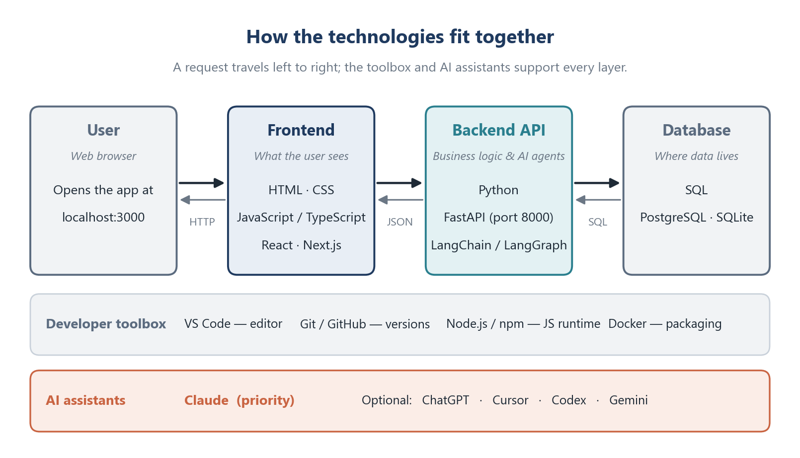

*Figure 1. Main technologies.*

### 0.2 Programming, query and web languages

| Component | Main objective | Purpose in this project | Typical applications |
|---|---|---|---|
| **Python** | General-purpose language that is easy to read and write | Backend API (FastAPI), AI agents (LangChain/LangGraph), tests, scripts | Web backends, data analysis, machine learning, automation |
| **JavaScript** | The programming language of web browsers | Makes the web interface interactive | Interactive websites, web apps, browser extensions |
| **TypeScript** | JavaScript plus static **types**, compiled to JavaScript | Safer frontend code with Next.js/React; catches mistakes before running | Large web apps, team projects, Node.js services |
| **SQL** | Standard language to **query and manage** relational databases | Store and retrieve project data (PostgreSQL in production, SQLite in development) | Reporting, analytics, any application that stores records |
| **HTML** | Describes the **structure** of a web page (headings, forms, buttons) | Skeleton of every frontend page | Websites, emails, documentation |
| **CSS** | Describes the **appearance** of a web page (layout, colours, fonts) | Styling and responsive layout of the frontend | Visual design of websites and apps |

In short: **HTML** gives the page its structure, **CSS** makes it look good, **JavaScript/TypeScript** make it interactive, **Python** does the work on the server, and **SQL** stores the results.

### 0.3 AI tools

| Tool | Provider | Main objective | Best used for |
|---|---|---|---|
| **Claude** (Claude Code, Desktop app, VS Code extension) | Anthropic | AI assistant and **agentic coding tool** that reads your codebase, edits files, runs commands and works with Git | Building features, fixing bugs, explaining code, writing tests and documents |
| **ChatGPT** | OpenAI | General conversational assistant | Brainstorming, explanations, second opinions |
| **Cursor** | Anysphere | AI-first code editor based on VS Code | Inline AI completions and chat inside an editor |
| **Codex** | OpenAI | Coding agent for the terminal and cloud | Alternative coding agent for comparison |
| **Gemini** (app, Gemini CLI) | Google | General assistant and terminal coding agent | Alternative assistant; long-document questions |

> **Note:** for `CLAUDE.md`, `.claude/`, `.cursor/`, `.codex/` and `.gemini/` in the project root, plus shared rules in `.agents/rules/`. Each tool reads its own folder automatically, so the whole team gets the same rules.

### 0.4 Supporting tools

| Tool | What it is | Why we need it |
|---|---|---|
| **Visual Studio Code** | Free code editor from Microsoft | One place to edit code, run a terminal and use Claude |
| **Git** | Version control system | Track every change and collaborate on branch `ai4b_tur` |
| **Node.js / npm** | JavaScript runtime and package manager | Required to build and run Next.js/React frontends |
| **FastAPI** | Python web framework | Builds the backend REST API with automatic `/docs` page |
| **Docker** | Container platform | Run the app the same way on every computer and in deployment |
| **Next.js / React** | Frontend frameworks | Build the user interface with reusable components |

### 0.5 Installation order and requirements

Install the tools in the order below. Git comes first because Claude Code on Windows needs Git Bash, and Node.js comes before the frontend frameworks because they run on it.

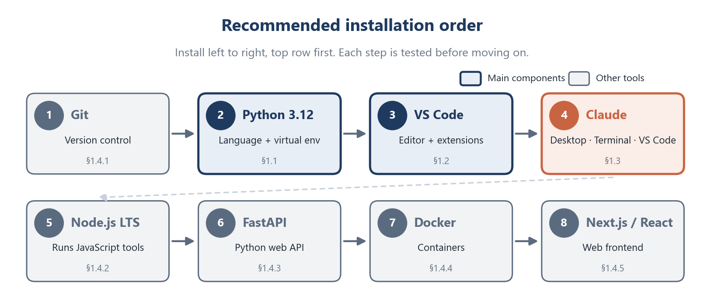

*Figure 2. Recommended installation order. Dark blue and orange boxes are the main components; grey boxes are the other tools.*

| Requirement | Minimum |
|---|---|
| **Operating system** | Windows 10 (version 1809+) or 11 · macOS 13 Ventura or newer · Ubuntu 20.04+ / Debian 10+ |
| **Memory (RAM)** | 4 GB (8 GB or more recommended when Docker is running) |
| **Free disk space** | About 10 GB for all tools and Docker images |
| **Accounts** | GitHub account with **Write** access to the repo · Claude **Pro, Max, Team or Enterprise** plan (or a Claude Console account) for Claude Code |
| **Internet** | Required for installing and for Claude |

---

## 1. Installations and Environment Setup

### 1.0 Before you start

#### Step 1 — Open a terminal

A **terminal** is a window where you type commands.

| OS | How to open it |
|---|---|
| **Windows** | Press **Start**, type `PowerShell`, press **Enter** |
| **macOS** | Press **Cmd + Space**, type `Terminal`, press **Enter** |
| **Linux** | Press **Ctrl + Alt + T** |

Example with Windows:

- **PowerShell:** search > PowerShell

  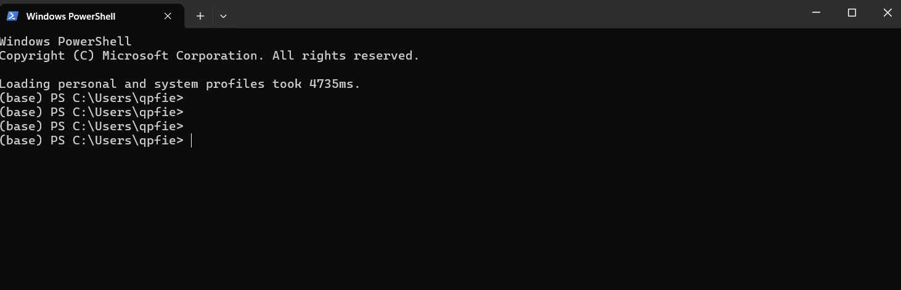

  *PowerShell Window*

- **Command Prompt:** search > cmd > Command Prompt (Run as Administrator)

  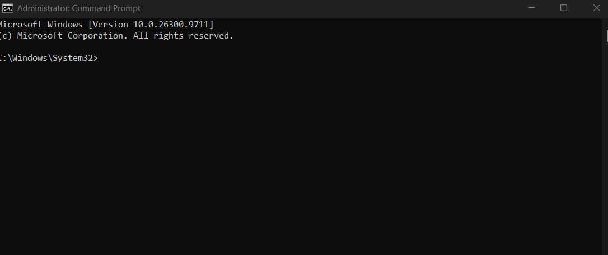

#### Step 2 — Get a package manager

A **package manager** installs software with one command. The commands in this guide use these.

**Windows** — `winget` is built into Windows 10/11. Check that it works:

```powershell
winget --version
```

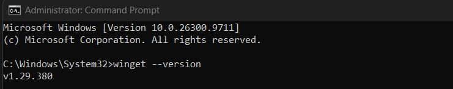

**macOS** — install Homebrew:

```bash
/bin/bash -c "$(curl -fsSL https://raw.githubusercontent.com/Homebrew/install/HEAD/install.sh)"
brew --version
```

**Linux (Ubuntu/Debian)** — `apt` is built in. Refresh the package list:

```bash
sudo apt update
```

#### Step 3 — Understand PATH (environment variables)

**Environment variables** are settings that every program can read. The most important one is **`PATH`**: a list of folders where the terminal looks for programs. When you see *"command not found"* or *"is not recognized"*, the program is usually installed but its folder is not on `PATH`.

**Windows (PowerShell)** — show the folders on PATH:

```powershell
$env:Path -split ';'
```

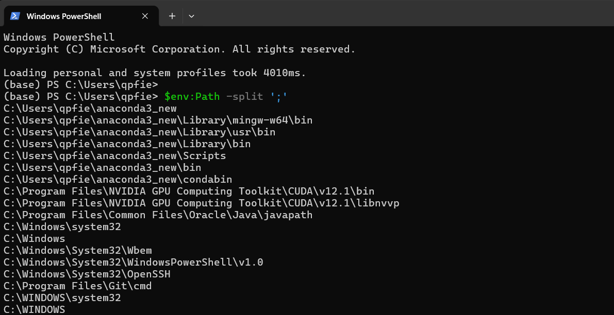

**macOS / Linux** — show the folders on PATH:

```bash
echo $PATH | tr ':' '\n'
```

> **Important:** After installing a program or changing `PATH`, **close and reopen the terminal** (and VS Code). Open terminals keep the old value.

---

### 1.1 Python

Python 3.12 is recommended (3.11 also works).

#### Step 1 — Download and install

- **Windows (PowerShell)**

  ```powershell
  winget install -e --id Python.Python.3.12
  ```

- Or download the installer from **python.org/downloads**. On the first screen, tick **"Add python.exe to PATH"**, then click **Install Now**.
- Test in terminal PowerShell:

  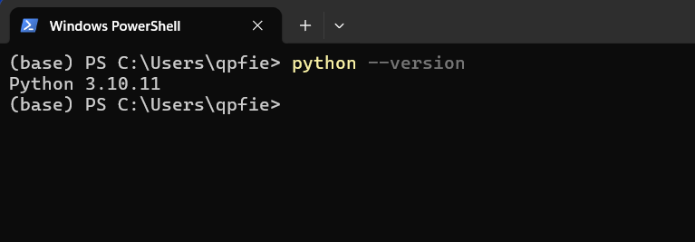

**macOS (Terminal)**

```bash
brew install python@3.12
```

**Linux (Ubuntu 24.04 already ships Python 3.12)**

```bash
sudo apt install -y python3 python3-venv python3-pip
```

On Ubuntu 22.04, add Python 3.12 from the deadsnakes repository:

```bash
sudo add-apt-repository ppa:deadsnakes/ppa
sudo apt update
sudo apt install -y python3.12 python3.12-venv
```

#### Step 2 — Set the environment variable (PATH)

**Windows** — if `python` is not found after installation (common error):

1. Press **Start**, type **"Edit environment variables for your account"**, open it.
2. Select **Path** → **Edit** → **New**, and add these two lines (replace `<you>` with your user name):
   `C:\Users\<you>\AppData\Local\Programs\Python\Python312\` and `C:\Users\<you>\AppData\Local\Programs\Python\Python312\Scripts\`

   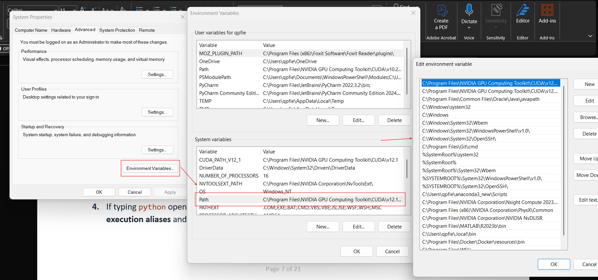

3. Click **OK**, then close and reopen PowerShell.
4. If typing `python` opens the **Microsoft Store**, open **Settings → Apps → Advanced app settings → App execution aliases** and switch off **python.exe** and **python3.exe**.

   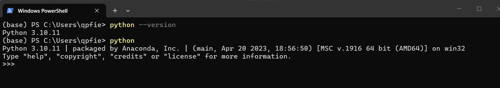

**macOS / Linux** — Homebrew and apt already put Python on PATH. To check which Python runs, and to add a folder to PATH permanently:

```bash
which python3
echo 'export PATH="$HOME/.local/bin:$PATH"' >> ~/.zshrc    # macOS (zsh)
echo 'export PATH="$HOME/.local/bin:$PATH"' >> ~/.bashrc   # Linux (bash)
```

> **Using Anaconda?** If your prompt starts with `(base)`, the Anaconda Python is active and may be a different version. Run `conda deactivate` before creating the project environment, or create the virtual environment with the exact version: `py -3.12 -m venv .venv` (Windows) or `python3.12 -m venv .venv` (macOS/Linux).

#### Step 3 — Test the installation

**Windows (Terminal: PowerShell or Command Prompt)**

```powershell
python --version
python -m pip --version
python -c "print('Hello from Python')"
```

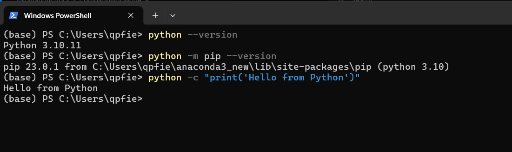

**macOS / Linux**

```bash
python3 --version
python3 -m pip --version
python3 -c "print('Hello from Python')"
```

> **Check:** You see `Python 3.12.x`, a `pip` version, and `Hello from Python`.

#### Step 4 — Create a virtual environment for the project (recommended)

A **virtual environment** (`.venv`) is a private folder of Python packages for one project. It keeps this project's packages separate from every other project on your computer. Create it **once**, inside the project folder.

**Windows (PowerShell)**

```powershell
cd C:\Users\<you>\PycharmProjects\AI_Tur\mt-01-the-odyssey
python -m venv .venv
.venv\Scripts\Activate.ps1
```

If PowerShell says *"running scripts is disabled on this system"*, allow local scripts once, then activate again:

```powershell
Set-ExecutionPolicy -ExecutionPolicy RemoteSigned -Scope CurrentUser
```

**macOS / Linux**

```bash
cd ~/path/to/mt-01-the-odyssey
python3 -m venv .venv
source .venv/bin/activate
```

> **Check:** Your prompt now starts with `(.venv)`. Run `deactivate` to leave the environment. **Activate it again every time you open a new terminal.**

#### Step 5 — Install the project packages and create `.env` (Important)

With `(.venv)` active, on any OS => In the terminal (PowerShell, Command Prompt):

```bash
python -m pip install --upgrade pip
pip install -r requirements.txt
```

Create your private settings file from the template.

**Windows**

```powershell
Copy-Item .env.example .env
```

**macOS / Linux**

```bash
cp .env.example .env
```

> **Important:** `.env` holds your API keys and is listed in `.gitignore`. **Never commit `.env`** and never paste its contents into a chat.

#### Step 6 — First run (recommended)

1. Create a file `hello.py` containing `print("Hello, Odyssey!")` and run it with `python hello.py`.
2. Start the project API (keep this terminal open).

**macOS / Linux**

```bash
make run
```

**Windows** (`make` is not installed by default, so run the same command directly)

```powershell
uvicorn src.main:app --reload --host 0.0.0.0 --port 8000
```

3. Open **http://localhost:8000/docs** in your browser. You should see the **Swagger UI** page.
4. In a **second** terminal, check the health endpoint:

```bash
curl -s localhost:8000/health        # macOS / Linux
curl.exe -s localhost:8000/health    # Windows PowerShell
```

> **Check:** The response contains `"status":"ok"`. Press **Ctrl + C** in the first terminal to stop the server. Note: `make test` currently shows *2 passed, 3 errors*. This is expected and is fixed in session 02 (see `README.md`).

**Potential project folders after this step**

```text
mt-01-the-odyssey/
├── .venv/              ← virtual environment (private, not committed)
├── .env                ← your settings and keys (private, not committed)
├── .env.example        ← template for .env (committed)
├── requirements.txt    ← list of Python packages
├── Makefile            ← shortcuts: make run, make test, make lint
├── src/
│   ├── main.py         ← FastAPI entry point
│   ├── config.py       ← reads settings from .env
│   ├── api/  models/  services/  agents/
├── tests/              ← automated tests (pytest)
└── docs/               ← course material and this guide
```

---

### 1.2 Visual Studio Code (VS Code)

#### Step 1 — Download and install

**Windows**

```powershell
winget install -e --id Microsoft.VisualStudioCode
```

Or

If you use the installer from **code.visualstudio.com/download**, tick **"Add to PATH"** and **"Add 'Open with Code' action"**.

**macOS**

```bash
brew install --cask visual-studio-code
```

Then open VS Code, press **Cmd + Shift + P**, and run **"Shell Command: Install 'code' command in PATH"**.

**Linux**

```bash
sudo snap install code --classic
```

Or download the `.deb` file from code.visualstudio.com and run `sudo apt install ./code_*.deb`.

#### Step 2 — Test the installation

```bash
code --version
```

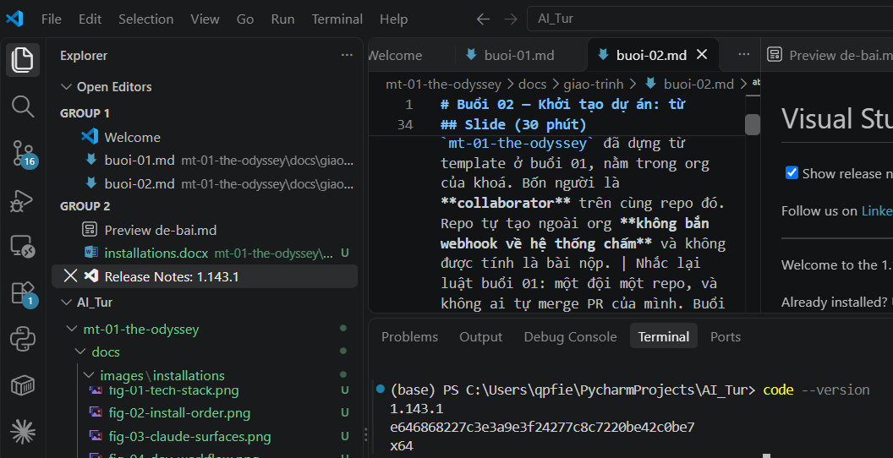

> **Check:** A version number is printed. Inside the project folder, `code .` opens the whole folder in VS Code.

#### Step 3 — Install the recommended extensions

| Extension | ID | Purpose |
|---|---|---|
| Python | `ms-python.python` | Run and debug Python, select the interpreter |
| Pylance | `ms-python.vscode-pylance` | Fast autocompletion and type hints |
| Ruff | `charliermarsh.ruff` | Lint and format Python (used by this repo) |
| **Claude Code** | `anthropic.claude-code` | Claude inside VS Code (see 1.3.3) |
| Docker | `ms-azuretools.vscode-docker` | Manage containers and Dockerfiles |
| ESLint | `dbaeumer.vscode-eslint` | Find problems in JavaScript/TypeScript |
| Prettier | `esbenp.prettier-vscode` | Format frontend code |

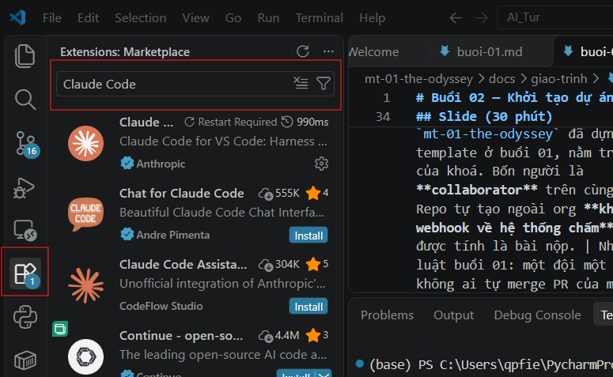

Or

Install them all at once from a terminal (same on every OS):

```bash
code --install-extension ms-python.python
code --install-extension ms-python.vscode-pylance
code --install-extension charliermarsh.ruff
code --install-extension anthropic.claude-code
code --install-extension ms-azuretools.vscode-docker
code --install-extension dbaeumer.vscode-eslint
code --install-extension esbenp.prettier-vscode
```

#### Step 4 — Open the project and select the Python interpreter

1. **File → Open Folder…** and choose `mt-01-the-odyssey`.
2. Press **Ctrl + Shift + P** (macOS: **Cmd + Shift + P**) → **Python: Select Interpreter** → choose the one inside **`.venv`**.

   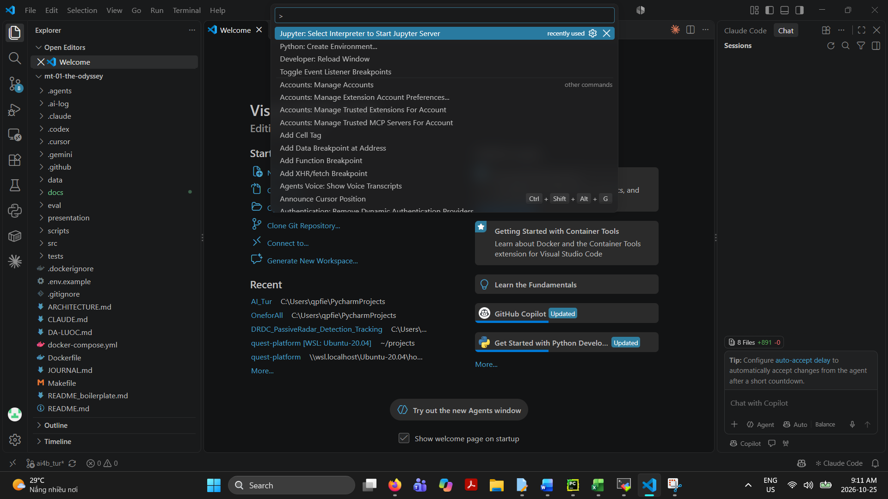

3. Open the built-in terminal with **Ctrl + `** (backtick). It activates `.venv` automatically.

#### Step 5 — First run

1. Open `hello.py`.
2. Click the **▶ Run Python File** button at the top right. The output appears in the terminal panel.
3. To debug, click to the left of a line number to set a red **breakpoint**, then press **F5**.

   Or run it in the terminal:

   ```bash
   python hello.py
   ```

> **Tip:** The `.vscode/` folder is in `.gitignore`, so your personal editor settings are never pushed to the team.

---

### 1.3 Claude

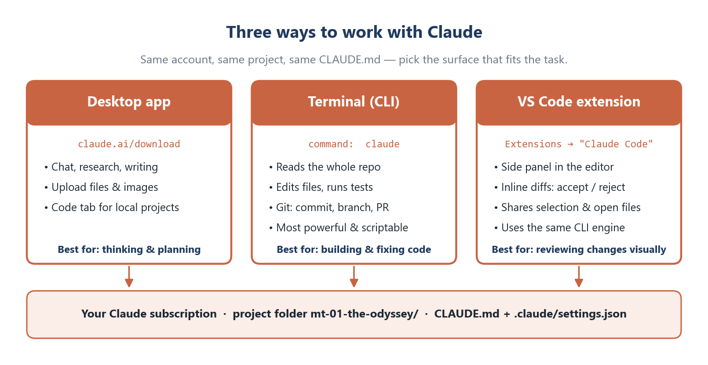

*Figure 3. The three ways to use Claude and what each is best for.*

> **Account:** Claude Code needs a paid **Claude Pro, Max, Team or Enterprise** plan, or a **Claude Console** (API) account. Check the current plans at claude.com/pricing.

#### 1.3.1 Claude Code in the terminal (most important)

**Step 1 — Prerequisites.** On **Windows**, install **Git for Windows** first (section 1.4.1). Claude Code uses Git Bash to run commands. Nothing extra is needed on macOS or Linux. (https://code.claude.com/docs/en/overview#vs-code)

**Step 2 — Install.** Use the **native installer**, which updates itself automatically.

**Windows (PowerShell)**

```powershell
irm https://claude.ai/install.ps1 | iex
```

**Windows (Command Prompt)**

```bat
curl -fsSL https://claude.ai/install.cmd -o install.cmd && install.cmd && del install.cmd
```

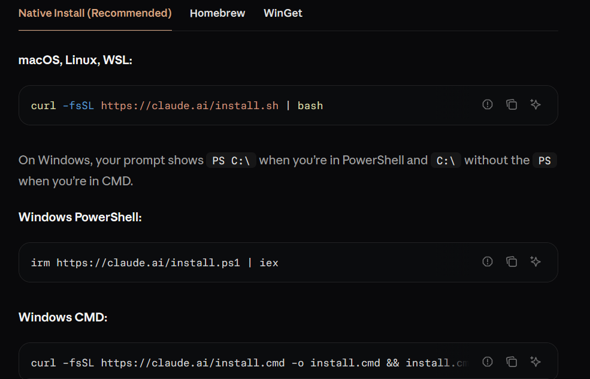

**macOS / Linux / WSL**

```bash
curl -fsSL https://claude.ai/install.sh | bash
```

Alternatives: `brew install --cask claude-code` (macOS), `winget install Anthropic.ClaudeCode` (Windows), or `npm install -g @anthropic-ai/claude-code` (any OS with Node.js 18+).

**Step 3 — Environment variable (PATH).** The native installer places the `claude` program in **`~/.local/bin`** (Windows: **`%USERPROFILE%\.local\bin`**). If `claude` is *not recognized*, add that folder to PATH as shown in section 1.1 Step 2, then reopen the terminal.

**Step 4 — Test the installation**

```bash
claude --version
claude doctor
```

- Click on this symbol in VS Code to open the terminal panel:

  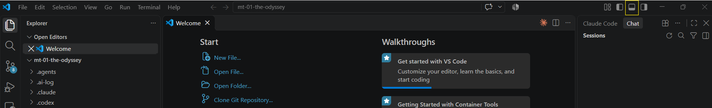

- Test the installation with the commands above:

  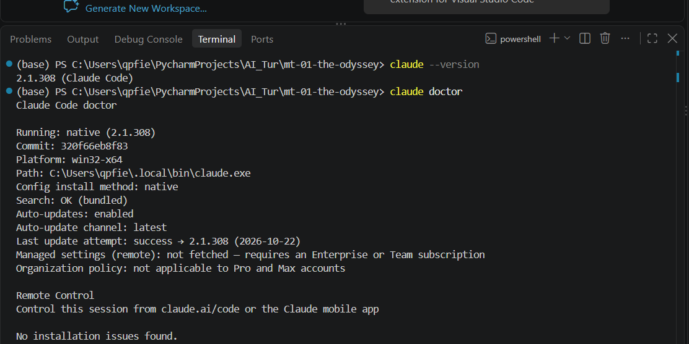

> **Check:** A version number is printed, and `claude doctor` reports no errors.

**Step 5 — First run and login**

```bash
cd mt-01-the-odyssey
claude
```

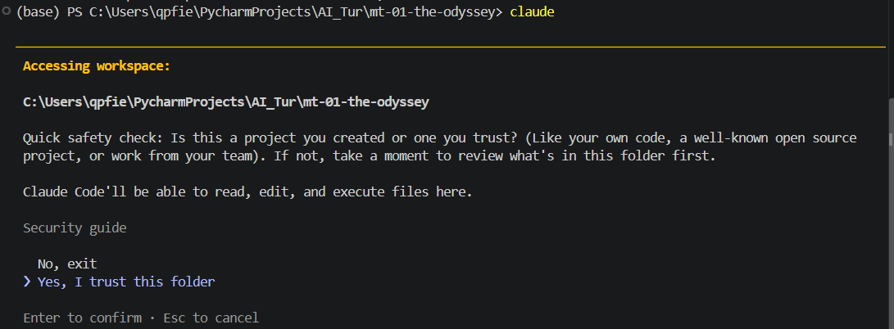

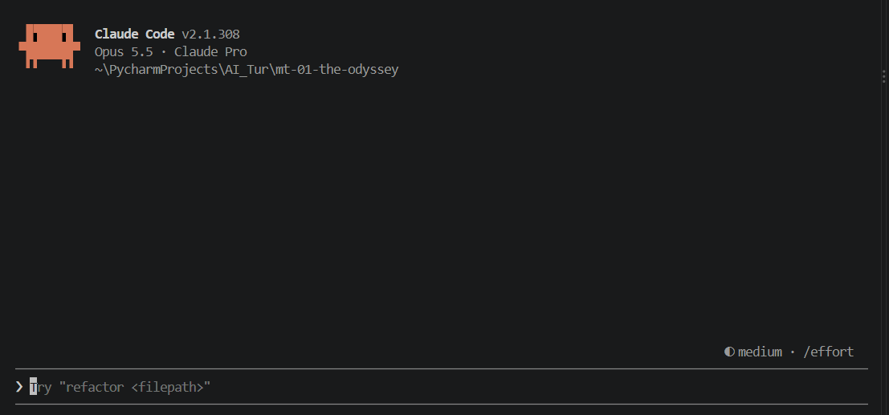

Ten Ten. We almost finished the set-up :D !!!

> **Note:** For the new user, we need to choose a **login method** (your Claude subscription, or Console account). A browser window opens; sign in and approve.

> **Important:** This repo **already has a `CLAUDE.md`**, so Claude follows the course rules automatically. Do **not** run `/init` here, because it would rewrite that file. Use `/init` only in a new project to generate a first `CLAUDE.md`.

**Essential commands**

| Command / key | What it does |
|---|---|
| `claude` | Start an interactive session in the current folder |
| `claude "explain src/main.py"` | Start a session with a first question |
| `claude -p "summarise README.md"` | One-shot answer, then exit (good for scripts) |
| `claude -c` | Continue the most recent conversation |
| `claude -r` | Pick an older conversation to resume |
| `claude update` | Update to the latest version |
| `/help` | List all commands |
| `/clear` | Start a fresh conversation (frees context) |
| `/compact` | Summarise the conversation to save context |
| `/model` | Choose the Claude model |
| `/memory` | Edit the `CLAUDE.md` memory files |
| `/login` · `/logout` | Switch account |
| `@path/to/file` | Point Claude at a specific file |
| `!command` | Run a shell command yourself; output goes into the chat |
| **Shift + Tab** | Switch permission mode (normal / auto-accept edits / plan) |
| **Esc** | Stop Claude; **Esc Esc** goes back to an earlier message |

**Files and folders Claude uses**

```text
mt-01-the-odyssey/
├── CLAUDE.md                  ← project instructions, shared with the team (committed)
├── .claude/
│   ├── settings.json          ← shared project settings and hooks (committed)
│   ├── settings.local.json    ← your personal overrides (not committed)
│   ├── commands/              ← optional custom slash commands
│   └── agents/                ← optional custom subagents
└── .agents/rules/             ← course rules referenced by CLAUDE.md

~/.claude/                     ← your user folder (all projects)
├── settings.json              ← personal global settings
└── CLAUDE.md                  ← personal instructions for every project
```

> **Note:** `.claude/settings.json` in this repo runs **AI-logging hooks** with `bash`. On Windows these need Git Bash (installed with Git). Install the Git push hook once after cloning: `bash scripts/setup_hooks.sh` (macOS/Linux/Git Bash) or `powershell -ExecutionPolicy Bypass -File scripts\setup_hooks.ps1` (Windows).

#### 1.3.2 Claude Desktop app

**Step 1 — Download and install.**

- **Windows:** download the installer from **claude.ai/download** and run it.
- **macOS:** download the `.dmg` from **claude.ai/download** and drag **Claude** into **Applications**.
- **Linux:** there is no official desktop app. Use **claude.ai** in your browser together with Claude Code in the terminal.

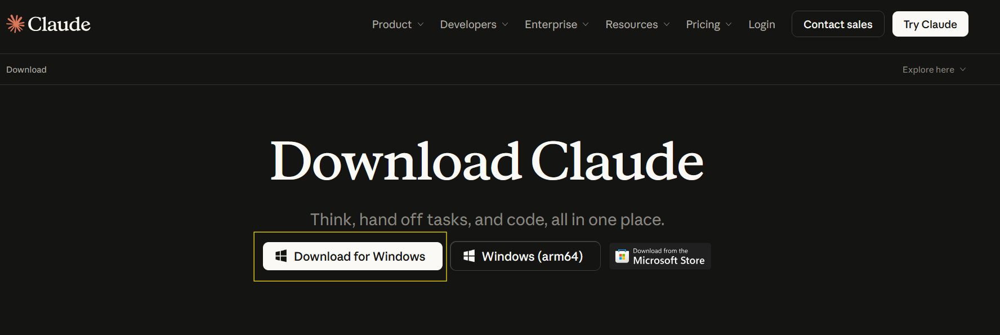

**Step 2 — Sign in and test.** Open Claude and sign in with the same account.

**Step 3 — First run with the project.** Use the **chat** for planning, explanations and documents; attach files with the paperclip icon. To work on code from the app, open the **Code** tab, choose the `mt-01-the-odyssey` folder, and describe the task. It runs the same Claude Code engine as the terminal.

#### 1.3.3 Claude Code extension for VS Code

**Step 1 — Install.** In VS Code, open **Extensions** (**Ctrl + Shift + X**, macOS **Cmd + Shift + X**), search **"Claude Code"**, check that the publisher is **Anthropic**, and click **Install**. From a terminal you can run:

```bash
code --install-extension anthropic.claude-code
```

**Step 2 — Open and sign in.** Click the **Claude (spark) icon** in the editor toolbar or sidebar, or press **Ctrl + Shift + P** → **"Claude Code: Open"**. Sign in when asked.

**Step 3 — First run.**

1. Open `src/main.py` and select a few lines.
2. In the Claude panel, ask *"Explain the selected code"*. Claude sees your selection automatically.
3. Ask for a small change, for example *"Add a docstring to this function"*. Claude shows the change as a **diff**: review it, then **Accept** or **Reject**.

> **Tip:** Running `claude` in the VS Code built-in terminal also connects to the editor, so diffs open in VS Code. Requires VS Code 1.98 or newer.

#### 1.3.4 Which one should I use?

| | Desktop app | Terminal (CLI) | VS Code extension |
|---|---|---|---|
| **Best for** | Planning, research, writing | Building, testing, Git work | Reviewing changes visually |
| **Reads project files** | In the Code tab | Yes | Yes |
| **Edits files / runs commands** | In the Code tab | Yes | Yes |
| **Start it with** | Claude app icon | `claude` | Spark icon in VS Code |

=> **Terminal is priority.**

---

### 1.4 Other tools

#### 1.4.1 Git

**Step 1 — Download and install**

**Windows**

```powershell
winget install -e --id Git.Git
```

Keep the default options in the installer. They include **Git Bash** and **Git Credential Manager**.

Or download directly from the website: https://git-scm.com/install/

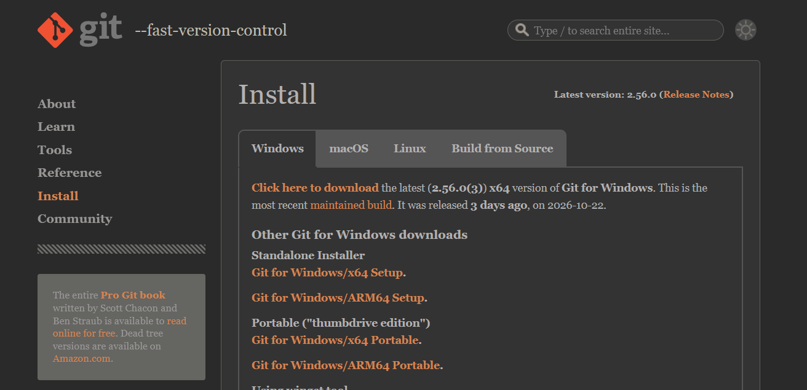

**macOS**

```bash
brew install git
```

**Linux**

```bash
sudo apt install -y git
```

**Step 2 — Test and configure (once per computer)**

```bash
git --version
git config --global user.name "Your Name"
git config --global user.email "you@example.com"
git config --global init.defaultBranch main
```

Open Git Bash:

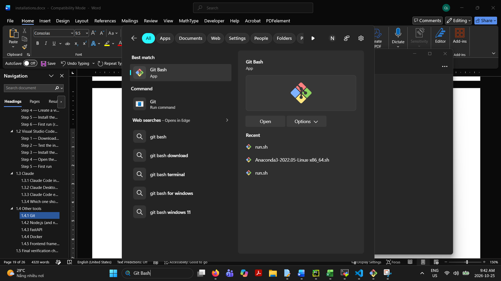

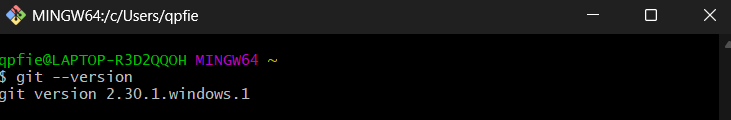

> **Check:** `git --version` prints a version, and `git config --global --list` shows your name and email. Use the **same email as your GitHub account**.

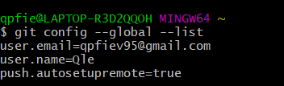

**Step 3 — Connect to GitHub.** The first `git push` opens a browser window to sign in to GitHub (Git Credential Manager). If it fails, install the GitHub CLI and sign in with it. When asked, choose **GitHub.com → HTTPS → Login with a web browser**.

```bash
winget install -e --id GitHub.cli      # Windows
brew install gh                        # macOS
gh auth login                          # all systems
```

On Linux, follow the GitHub CLI install instructions at cli.github.com.

> **Error 403 "Permission denied":** you signed in, but your account has no **Write** access. Accept the repository invitation on GitHub, or ask the owner to give you Write access.

**Step 4 — First run: clone and work on the team branch**

```bash
git clone https://github.com/UEH-ISB/mt-01-the-odyssey.git
cd mt-01-the-odyssey
git switch ai4b_tur              # use the team branch
git pull                         # get the latest changes
# ... edit files ...
git status                       # see what changed
git add .
git commit -m "docs: describe your change"
git push
```

When the work is ready, open GitHub → **Pull requests → New pull request**, set **base: `main`** and **compare: `ai4b_tur`**, and ask a teammate to review and merge.

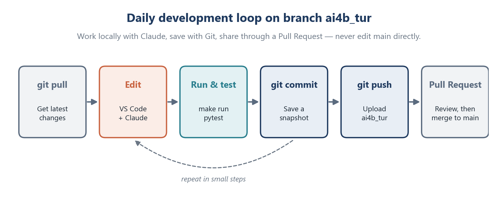

*Figure 4. The daily development loop on the team branch.*

#### 1.4.2 Node.js (and npm)

Install the current **LTS** (Long-Term Support) version. Next.js needs Node.js **20.9 or newer**.

**Step 1 — Download and install**

**Windows**

```powershell
winget install -e --id OpenJS.NodeJS.LTS
```

**macOS**

```bash
brew install node
```

**Linux** (with nvm, the Node Version Manager)

```bash
curl -o- https://raw.githubusercontent.com/nvm-sh/nvm/v0.40.1/install.sh | bash
source ~/.bashrc
nvm install --lts
```

**Step 2 — Test**

```bash
node -v
npm -v
npx -v
```

> **Check:** Three version numbers are printed (for example `v22.x`, `10.x`, `10.x`). On Windows, if `npm` is blocked by *"running scripts is disabled"*, use the `Set-ExecutionPolicy` command from section 1.1 Step 4.

**Step 3 — First run.** Create `hello.js` containing `console.log("Hello from Node.js");` and run `node hello.js`.

#### 1.4.3 FastAPI

FastAPI is a Python package, so it is installed **inside the virtual environment** and the steps are the same on every OS. In this repo it is already listed in `requirements.txt`. The steps below show how to start a FastAPI app from scratch.

**Step 1 — Install** (with `(.venv)` active)

```bash
pip install "fastapi[standard]"
```

**Step 2 — Test**

```bash
python -c "import fastapi; print(fastapi.__version__)"
```

**Step 3 — Create a first app** in a file named `main.py`:

```python
from fastapi import FastAPI

app = FastAPI()


@app.get("/")
def read_root():
    return {"message": "Hello, Odyssey!"}


@app.get("/items/{item_id}")
def read_item(item_id: int, q: str | None = None):
    return {"item_id": item_id, "q": q}
```

**Step 4 — First run**

```bash
fastapi dev main.py
```

> **Check:** Open **http://127.0.0.1:8000** to see `{"message":"Hello, Odyssey!"}`, and **http://127.0.0.1:8000/docs** to try the API interactively. For the project itself, use `make run` (or the `uvicorn` command in section 1.1 Step 6).

#### 1.4.4 Docker

**Step 1 — Download and install**

**Windows** — Docker Desktop runs on WSL 2. Open PowerShell **as Administrator**:

```powershell
wsl --install
winget install -e --id Docker.DockerDesktop
```

Restart the computer, open **Docker Desktop**, and accept the terms. Keep **"Use WSL 2 based engine"** turned on.

**macOS** — download **Docker Desktop** for your chip (**Apple silicon** or **Intel**) from docs.docker.com, open the `.dmg`, and drag Docker into **Applications**. Start Docker from Applications.

**Linux** — install Docker Engine and allow your user to run it without `sudo`:

```bash
curl -fsSL https://get.docker.com -o get-docker.sh
sudo sh get-docker.sh
sudo usermod -aG docker $USER
newgrp docker
```

**Step 2 — Test**

```bash
docker --version
docker compose version
docker run hello-world
```

> **Check:** The last command prints *"Hello from Docker!"*. On Windows and macOS, **Docker Desktop must be running** first (whale icon in the taskbar or menu bar).

**Step 3 — First run with the project.** The repo includes a `Dockerfile` and `docker-compose.yml`. Make sure `.env` exists (section 1.1 Step 5), then:

```bash
docker compose up --build
```

Open **http://localhost:8000/health**. Stop with **Ctrl + C**, then remove the containers with `docker compose down`.

#### 1.4.5 Frontend frameworks: Next.js and React

Both need Node.js (section 1.4.2), and the commands are the same on Windows, macOS and Linux. Run them in the folder **where you want the new app to be created**.

**Option A — Next.js (recommended, full-stack React framework)**

```bash
npx create-next-app@latest frontend
```

Accept the recommended defaults: **TypeScript**, **ESLint**, **Tailwind CSS**, **App Router**. Then start it:

```bash
cd frontend
npm run dev
```

> **Check:** Open **http://localhost:3000** to see the Next.js start page. Edit `app/page.tsx`, save, and the page updates immediately.

**Option B — React with Vite (lightweight single-page app)**

```bash
npm create vite@latest frontend-react -- --template react-ts
cd frontend-react
npm install
npm run dev
```

> **Check:** Open **http://localhost:5173**.

**Typical Next.js folder structure**

```text
frontend/
├── app/
│   ├── layout.tsx      ← shared page layout (HTML skeleton)
│   ├── page.tsx        ← home page (React + TypeScript)
│   └── globals.css     ← global styles (CSS / Tailwind)
├── public/             ← images and static files
├── package.json        ← npm scripts and dependencies
└── .env.local          ← NEXT_PUBLIC_API_URL=http://localhost:8000 (not committed)
```

> **Connecting to the backend:** `.env` already allows the frontend addresses `http://localhost:3000` and `http://localhost:5173` in `CORS_ORIGINS`, so the browser may call the FastAPI backend on port 8000.

---

### 1.5 Final verification checklist

Run each command in a **new** terminal. Tick the box when the expected result appears.

| # | Command | Expected result |
|---|---|---|
| 1 | `git --version` | `git version 2.x` |
| 2 | `python --version` (macOS/Linux: `python3`) | `Python 3.12.x` |
| 3 | `code --version` | VS Code version number |
| 4 | `claude --version` | Claude Code version number |
| 5 | `claude doctor` | No errors reported |
| 6 | `node -v` and `npm -v` | `v20.9` or newer, and an npm version |
| 7 | `docker run hello-world` | *Hello from Docker!* |
| 8 | `make run` (Windows: `uvicorn` command) → open `/docs` | Swagger UI page loads |
| 9 | `curl localhost:8000/health` (Windows: `curl.exe`) | `"status":"ok"` |

**Ports used in development**

| Port | Service |
|---|---|
| `8000` | FastAPI backend (`/docs`, `/health`) |
| `3000` | Next.js frontend |
| `5173` | React + Vite frontend |
| `5432` | PostgreSQL database (if used) |

---

## 2. References

**Claude**

- Claude Code overview — https://code.claude.com/docs/en/overview
- Claude Code quickstart — https://code.claude.com/docs/en/quickstart
- Claude Code changelog — https://code.claude.com/docs/en/changelog
- Set up Claude Code (install, update, uninstall) — https://code.claude.com/docs/en/setup
- Claude Code in VS Code — https://code.claude.com/docs/en/vs-code
- Claude Code on desktop — https://code.claude.com/docs/en/desktop
- Memory and CLAUDE.md — https://code.claude.com/docs/en/memory
- Settings — https://code.claude.com/docs/en/settings
- CLI reference — https://code.claude.com/docs/en/cli-reference
- Common workflows — https://code.claude.com/docs/en/common-workflows
- Troubleshooting — https://code.claude.com/docs/en/troubleshooting
- Download the Claude apps — https://claude.ai/download

**Python**

- Downloads — https://www.python.org/downloads/
- Using Python on Windows — https://docs.python.org/3/using/windows.html
- venv — virtual environments — https://docs.python.org/3/library/venv.html
- Installing packages — https://packaging.python.org/en/latest/tutorials/installing-packages/

**Visual Studio Code**

- Setup overview — https://code.visualstudio.com/docs/setup/setup-overview
- Python in VS Code — https://code.visualstudio.com/docs/python/python-tutorial

**Git and GitHub**

- Git downloads — https://git-scm.com/downloads
- Pro Git book — https://git-scm.com/book/en/v2
- Set up Git (GitHub) — https://docs.github.com/en/get-started/git-basics/set-up-git
- About pull requests — https://docs.github.com/en/pull-requests
- GitHub CLI — https://cli.github.com/

**Node.js**

- Download Node.js — https://nodejs.org/en/download
- nvm (Node Version Manager) — https://github.com/nvm-sh/nvm
- npm documentation — https://docs.npmjs.com/

**FastAPI**

- FastAPI documentation — https://fastapi.tiangolo.com/
- Tutorial: first steps — https://fastapi.tiangolo.com/tutorial/first-steps/

**Docker**

- Get Docker — https://docs.docker.com/get-started/get-docker/
- Docker Desktop on Windows — https://docs.docker.com/desktop/setup/install/windows-install/
- Docker Desktop on Mac — https://docs.docker.com/desktop/setup/install/mac-install/
- Docker Engine on Ubuntu — https://docs.docker.com/engine/install/ubuntu/
- Linux post-install steps — https://docs.docker.com/engine/install/linux-postinstall/
- Install WSL — https://learn.microsoft.com/en-us/windows/wsl/install

**Next.js and React**

- Next.js installation — https://nextjs.org/docs/app/getting-started/installation
- Learn React — https://react.dev/learn
- Vite guide — https://vite.dev/guide/

**Web languages and SQL**

- HTML (MDN) — https://developer.mozilla.org/en-US/docs/Web/HTML
- CSS (MDN) — https://developer.mozilla.org/en-US/docs/Web/CSS
- JavaScript (MDN) — https://developer.mozilla.org/en-US/docs/Web/JavaScript
- TypeScript handbook — https://www.typescriptlang.org/docs/
- PostgreSQL documentation — https://www.postgresql.org/docs/
- SQLite documentation — https://www.sqlite.org/docs.html

**Package managers and other AI tools**

- winget — https://learn.microsoft.com/en-us/windows/package-manager/winget/
- Homebrew — https://brew.sh/
- ChatGPT help center — https://help.openai.com/
- OpenAI Codex — https://developers.openai.com/codex
- Cursor — https://cursor.com/
- Gemini CLI — https://github.com/google-gemini/gemini-cli

---

## Appendix A — Troubleshooting

Read the **`ERROR` line** (or the last line of a Python `Traceback`) first, and ignore `[notice]` and `WARNING` lines. Paste the error **as text**, not as a screenshot, when asking a teammate or Claude for help.

| Problem | Likely cause | Fix |
|---|---|---|
| `python` / `claude` / `code` *is not recognized* or *command not found* | Program folder not on PATH | Add the folder to PATH (1.1 Step 2), then reopen the terminal |
| Typing `python` opens the Microsoft Store | Windows app execution alias | Turn off the python aliases (1.1 Step 2) |
| *Activate.ps1 cannot be loaded… running scripts is disabled* | PowerShell execution policy | `Set-ExecutionPolicy -ExecutionPolicy RemoteSigned -Scope CurrentUser` |
| `pip install` puts packages in the wrong place | `.venv` not active | Activate `.venv`, then use `python -m pip install …` |
| `make: command not found` on Windows | `make` is not installed | Use the `uvicorn …` command from 1.1 Step 6 |
| `Address already in use` / port 8000 busy | Another server is running | Stop it with **Ctrl + C**, or use `--port 8001` |
| `git push` → *403 Permission denied* | No Write access to the repo | Accept the GitHub invitation or ask the owner for Write access |
| `docker: Cannot connect to the Docker daemon` | Docker is not running | Start Docker Desktop (or `sudo systemctl start docker` on Linux) |
| Claude Code hooks fail on Windows with `bash` errors | Git Bash missing | Install Git for Windows (1.4.1), then restart the terminal |
